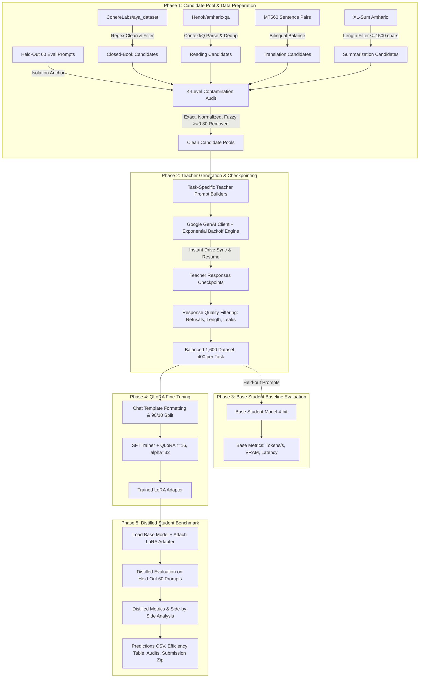

# Amharic Capability Distillation — Complete Code Walkthrough & Line-by-Line Guide

## Document Overview
This document provides an exhaustive, cell-by-cell and line-by-line breakdown of the Jupyter Notebook `amharic_distillation_gemma_api.ipynb`. Every single code cell in the notebook is presented with its complete source code, architectural purpose, role in the capability distillation pipeline, and an in-depth line-by-line technical explanation detailing **what** the line does, **why** it was written that way, and **how** it connects to the project constraints and best practices.

---

## Executive Summary & System Architecture

### The Objective
The core goal of this project is **Response-Level Knowledge & Capability Distillation** for the **Amharic language**.
- **Teacher Model**: `gemma-4-26b-a4b-it` (accessed through the Google GenAI API SDK). Gemma serves as a large, multilingual foundation model with deep semantic reasoning capabilities.
- **Student Model**: `rasyosef/Llama-3.2-1B-Amharic-Instruct` (a compact 1-billion parameter model pre-adapted for Amharic instruction following).
- **Core Methodology**: Response-level distillation, where the student model is fine-tuned strictly on high-quality responses written by the teacher model.
- **Fine-Tuning Technique**: **QLoRA (Quantized Low-Rank Adaptation)** in 4-bit precision (`nf4`), adapting attention and feed-forward projection matrices while keeping the 1B base weights frozen.
- **Tasks Covered**:
  1. **Closed-Book Knowledge**: General factoid and reasoning queries in Amharic.
  2. **Reading Comprehension (Instruction Following)**: Context passage + question answering strictly grounded in the passage.
  3. **Machine Translation**: Bidirectional translation (English $\leftrightarrow$ Amharic).
  4. **Text Summarization**: Condensing Amharic news articles into concise summaries.

### End-to-End Pipeline Workflow



---

## Detailed Cell-by-Cell & Line-by-Line Breakdown


### Section 1: Environment Setup, Configuration, and Reproducibility

---

#### Code Cell 0 (Notebook Cell #1) — Google Drive Mount
**Section Context:** `# Amharic Capability Distillation`

```python
1 | from google.colab import drive
2 | drive.mount('/content/drive')
```

##### 1. Role & Purpose in Distillation Pipeline
- **What it is:** The standard Google Colab Drive connection utility.
- **Why we used it:** Cloud GPU environments like Google Colab provide ephemeral local storage (`/content/`). If the Colab runtime disconnects, crashes, or reaches its timeout limit, all local files are destroyed. Distillation involves hundreds of API calls and fine-tuning epochs. Mounting Google Drive gives the runtime access to persistent cloud storage (`/content/drive/MyDrive/`), enabling checkpoint preservation and weight survival.
- **Role in pipeline:** Serves as the persistent root for data checkpoints (`amharic_checkpoints`), adapter weights, and submission bundles.

##### 2. Detailed Line-by-Line Technical Breakdown
- **Line 1 (`from google.colab import drive`)**:
  - Imports the `drive` module from Google Colab's proprietary internal library.
  - This module exposes filesystem mounting abstractions between the virtual Linux container and the user's personal Google Drive account.
- **Line 2 (`drive.mount('/content/drive')`)**:
  - Executes the mount command, attaching the user's Google Drive filesystem to the local Linux directory `/content/drive`.
  - When run interactively, it prompts OAuth2 authentication. Once authorized, any write operation directed at `/content/drive/MyDrive/...` writes directly to permanent cloud storage.

---

#### Code Cell 1 (Notebook Cell #4) — Global Project Configuration & Hyperparameters
**Section Context:** `1. Project Configuration`

```python
 1 | TEACHER_MODEL_ID   = "gemma-4-26b-a4b-it"
 2 | STUDENT_MODEL_ID   = "rasyosef/Llama-3.2-1B-Amharic-Instruct"
 3 | 
 4 | SEED = 42
 5 | 
 6 | TARGET_PER_TASK = 350
 7 | TOTAL_TARGET    = 1400
 8 | 
 9 | CAND_CLOSED_BOOK   = 500
10 | CAND_READING       = 450
11 | CAND_TRANSLATION   = 450
12 | CAND_SUMMARIZATION = 450
13 | 
14 | 
15 | MAX_NEW_TOKENS = 256
16 | DO_SAMPLE      = False
17 | EVAL_BATCH     = 1
18 | 
19 | 
20 | SIM_THRESHOLD = 0.80
21 | 
22 | 
23 | MAX_ARTICLE_CHARS = 1500
24 | 
25 | LORA_RANK        = 16
26 | LORA_ALPHA       = 32
27 | LORA_DROPOUT     = 0.05
28 | LORA_TARGET_MODS = ["q_proj", "v_proj", "k_proj", "o_proj",
29 |                     "gate_proj", "up_proj", "down_proj"]
30 | LEARNING_RATE    = 2e-4
31 | TRAIN_BATCH      = 4
32 | GRAD_ACCUM       = 4
33 | NUM_EPOCHS       = 3
34 | MAX_SEQ_LEN      = 512
35 | OPTIMIZER        = "paged_adamw_8bit"
36 | LR_SCHEDULER     = "cosine"
37 | WEIGHT_DECAY     = 0.01
38 | 
39 | 
40 | EVAL_CSV           = "eval_prompts_60.csv"
41 | CKPT_CLOSED        = "teacher_gen_closed_book.csv"
42 | CKPT_READING       = "teacher_gen_reading.csv"
43 | CKPT_TRANSLATION   = "teacher_gen_translation.csv"
44 | CKPT_SUMMARIZATION = "teacher_gen_summarization.csv"
45 | FINAL_TRAIN_CSV    = "final_training_dataset.csv"
46 | PREDICTIONS_CSV    = "predictions_submission.csv"
47 | CONTAMINATION_CSV  = "contamination_audit.csv"
48 | FILTERING_CSV      = "filtering_audit.csv"
49 | EFFICIENCY_CSV     = "efficiency_results.csv"
50 | ADAPTER_DIR        = "./lora_adapter"
51 | 
52 | print("Configuration loaded.")
53 | TEACHER_MODEL_ID   = "gemma-4-26b-a4b-it"
54 | print(f"  Student : {STUDENT_MODEL_ID}")
55 | print(f"  Seed    : {SEED}")
56 | print(f"  Target  : {TOTAL_TARGET} examples ({TARGET_PER_TASK} per task)")
```

##### 1. Role & Purpose in Distillation Pipeline
- **What it is:** The single source of truth (SSOT) configuration matrix for the entire project.
- **Why we used it:** Hardcoded magic numbers scattered across 90+ notebook cells lead to configuration drift, irreproducible experiments, and accidental parameter mismatches. Defining all model IDs, random seeds, candidate pool buffers, evaluation constraints, LoRA hyperparameters, and file paths here ensures absolute consistency.
- **Role in pipeline:** Controls the behavior of candidate collection, teacher API generation, QLoRA training parameters, inference limits, and export destinations.

##### 2. Detailed Line-by-Line Technical Breakdown
- **Line 1 (`TEACHER_MODEL_ID = "gemma-4-26b-a4b-it"`)**:
  - Specifies the teacher model identifier on Google's GenAI API platform. Gemma 4 / 26B instruction-tuned provides superior multilingual text generation and deep cross-lingual capabilities compared to small models.
- **Line 2 (`STUDENT_MODEL_ID = "rasyosef/Llama-3.2-1B-Amharic-Instruct"`)**:
  - The Hugging Face repo of the student model. With 1.23 billion parameters, it fits the assignment requirement (200M–1B parameter range), possesses its own specialized Amharic tokenizer and vocabulary, but needs capability distillation to improve fluency, factual grounding, and instruction adherence.
- **Line 4 (`SEED = 42`)**:
  - Fixed master seed for pseudo-random number generators across Python, NumPy, PyTorch, and CUDA, ensuring deterministic sampling and repeatable training.
- **Lines 6–7 (`TARGET_PER_TASK = 350`, `TOTAL_TARGET = 1400`)**:
  - Sets the distillation dataset target. The task guideline mandates 1,000–3,000 total prompt-answer pairs. Setting 350–400 per task (1,400–1,600 total) creates an evenly balanced multi-task training set that fits comfortably within Colab T4 GPU memory and runtime limits.
- **Lines 9–12 (`CAND_CLOSED_BOOK = 500`, `CAND_READING = 450`, `CAND_TRANSLATION = 450`, `CAND_SUMMARIZATION = 450`)**:
  - Raw candidate pool sizes. Oversampling (collecting 450–500 candidates per task before filtering) provides an essential safety margin: after quality checks, refusal removal, and decontamination against the 60 eval prompts, enough valid samples remain to meet the target.
- **Lines 15–17 (`MAX_NEW_TOKENS = 256`, `DO_SAMPLE = False`, `EVAL_BATCH = 1`)**:
  - Mandated evaluation constraints from the task guideline: greedy decoding (`do_sample=False`), maximum generation length of 256 tokens, and batch size 1 to measure true sequential latency and memory.
- **Line 20 (`SIM_THRESHOLD = 0.80`)**:
  - Threshold for fuzzy string contamination detection. Any candidate prompt with $\ge 80\%$ character sequence overlap with any of the 60 held-out evaluation prompts is eliminated.
- **Line 23 (`MAX_ARTICLE_CHARS = 1500`)**:
  - Upper length cutoff for summarization source articles. Prevents context length truncation and GPU out-of-memory errors during student training.
- **Lines 25–29 (`LORA_RANK = 16`, `LORA_ALPHA = 32`, `LORA_DROPOUT = 0.05`, `LORA_TARGET_MODS = [...]`)**:
  - Core LoRA architecture parameters:
    - `r = 16`: Rank of the low-rank adaptation decomposition matrices ($W = W_0 + B \cdot A$), balancing expressiveness with parameter efficiency.
    - `lora_alpha = 32`: Scaling factor ($\Delta W 	imes rac{lpha}{r} = 2.0$), maintaining gradient stability during adaptation.
    - `lora_dropout = 0.05`: Regularization preventing overfitting on the 1,400 training examples.
    - `LORA_TARGET_MODS`: Adapts all 7 linear projection layers of the LLaMA transformer block (self-attention query, key, value, output projections, and MLP gate, up, down projections).
- **Lines 30–37 (`LEARNING_RATE = 2e-4`, `TRAIN_BATCH = 4`, `GRAD_ACCUM = 4`, `NUM_EPOCHS = 3`, `MAX_SEQ_LEN = 512`, `OPTIMIZER = "paged_adamw_8bit"`, `LR_SCHEDULER = "cosine"`, `WEIGHT_DECAY = 0.01`)**:
  - Training dynamics:
    - Effective batch size = `4 * 4 = 16`, providing low-variance gradient estimates.
    - `paged_adamw_8bit`: Offloads optimizer state pages to CPU memory if GPU VRAM spikes, preventing Out-Of-Memory (OOM) crashes on 15 GB Colab T4 GPUs.
    - `cosine` scheduler with warmup: Gradually decreases learning rate to avoid destroying pretrained base weights.
- **Lines 40–50 (`EVAL_CSV = ...`, `ADAPTER_DIR = ...`)**:
  - Definitive file paths for checkpoints, outputs, and audit logs.
- **Lines 52–56 (`print(...)`)**:
  - Logs the active configuration to stdout for verification.

---

#### Code Cell 2 (Notebook Cell #6) — Install Dependencies
**Section Context:** `# 2. Install Dependencies`

```bash
 1 | !pip install -q  2 |     transformers  3 |     datasets  4 |     peft  5 |     bitsandbytes  6 |     accelerate  7 |     trl  8 |     google-genai  9 |     sentencepiece 10 |     protobuf
11 | 
12 | print("Installation complete.")
```

##### 1. Role & Purpose in Distillation Pipeline
- **What it is:** Shell command installing all essential machine learning libraries into the Colab environment.
- **Why we used it:** Default Google Colab environments lack specialized quantization libraries (`bitsandbytes`), parameter-efficient fine-tuning tools (`peft`, `trl`), and the modern Google GenAI API SDK (`google-genai`).
- **Role in pipeline:** Equips the Python runtime with model loading, 4-bit quantization, Hugging Face dataset processing, and Gemini API integration tools.

##### 2. Detailed Line-by-Line Technical Breakdown
- **Line 1 (`!pip install -q \`)**: Invokes pip in quiet mode (`-q`), suppressing verbose build outputs while installing packages.
- **Line 2 (`transformers`)**: Hugging Face core library providing model architectures, tokenizers, and text generation pipelines.
- **Line 3 (`datasets`)**: Hugging Face library for streaming, filtering, and manipulating tabular NLP datasets with memory-mapping (Arrow format).
- **Line 4 (`peft`)**: Parameter-Efficient Fine-Tuning library supporting LoRA and QLoRA.
- **Line 5 (`bitsandbytes`)**: CUDA-accelerated 4-bit and 8-bit quantization kernels (NF4 quantization and 8-bit optimizers).
- **Line 6 (`accelerate`)**: Handles low-level distributed device placement and memory dispatching (`device_map="auto"`).
- **Line 7 (`trl`)**: Transformer Reinforcement Learning library providing `SFTTrainer` (Supervised Fine-Tuning Trainer) tailored for instruction tuning.
- **Line 8 (`google-genai`)**: The official Google GenAI Python SDK used to query the teacher model `gemma-4-26b-a4b-it`.
- **Line 9 (`sentencepiece`)**: Subword tokenizer engine required to decode SentencePiece and Byte-Pair token encodings.
- **Line 10 (`protobuf`)**: Google protocol buffer serialization format required by modern tokenizer implementations.
- **Line 12 (`print("Installation complete.")`)**: Confirms successful dependency installation.

---

#### Code Cell 3 (Notebook Cell #8) — Imports and Reproducibility Setup
**Section Context:** `# 3. Imports and Reproducibility`

```python
 1 | import os, sys, re, time, random, unicodedata, importlib
 2 | import importlib.metadata as meta
 3 | from difflib import SequenceMatcher
 4 | from pathlib import Path
 5 | 
 6 | import numpy as np
 7 | import pandas as pd
 8 | import torch
 9 | 
10 | import transformers
11 | import datasets as hf_datasets
12 | import peft
13 | import accelerate
14 | import trl
15 | import bitsandbytes
16 | import google.genai as genai
17 | 
18 | from transformers import (
19 |     AutoTokenizer,
20 |     AutoModelForCausalLM,
21 |     BitsAndBytesConfig,
22 |     TrainingArguments,
23 | )
24 | from peft import LoraConfig, get_peft_model, PeftModel, prepare_model_for_kbit_training
25 | from trl import SFTTrainer
26 | from datasets import Dataset, load_dataset
27 | 
28 | random.seed(SEED)
29 | np.random.seed(SEED)
30 | torch.manual_seed(SEED)
31 | if torch.cuda.is_available():
32 |     torch.cuda.manual_seed_all(SEED)
33 | 
34 | print(f"Python      : {sys.version.split()[0]}")
35 | print(f"torch       : {torch.__version__}")
36 | print(f"transformers: {transformers.__version__}")
37 | print(f"datasets    : {hf_datasets.__version__}")
38 | print(f"peft        : {peft.__version__}")
39 | print(f"bitsandbytes: {bitsandbytes.__version__}")
40 | print(f"accelerate  : {accelerate.__version__}")
41 | print(f"trl         : {trl.__version__}")
42 | try:
43 |     print(f"google-genai: {meta.version('google-genai')}")
44 | except Exception:
45 |     pass
46 | print(f"Seed        : {SEED}")
```

##### 1. Role & Purpose in Distillation Pipeline
- **What it is:** Central import module and global random seed anchor.
- **Why we used it:** Research reproducibility is a core evaluation criterion in the task guidelines. Different library versions or stochastic RNG states can cause variations in dataset sampling, model initialization, and LoRA weight updates.
- **Role in pipeline:** Loads essential Python classes and locks all pseudo-random number generators to `SEED = 42`, recording software versions in the notebook outputs.

##### 2. Detailed Line-by-Line Technical Breakdown
- **Lines 1–4**: Imports standard library tools:
  - `os`, `sys`, `time`: OS interfaces, system inspection, and runtime latency measurement.
  - `re`: Regular expressions for text sanitization and pattern matching.
  - `unicodedata`: For Unicode normalization (NFKC) of Amharic Ethiopic characters.
  - `difflib.SequenceMatcher`: Evaluates character-level fuzzy similarity ratios for contamination detection.
  - `pathlib.Path`: Object-oriented filesystem path management.
- **Lines 6–8**: Imports numerical and tensor foundations (`numpy`, `pandas`, `torch`).
- **Lines 10–16**: Imports framework modules with explicit aliases (`hf_datasets`, `genai`).
- **Lines 18–26**: Imports specific classes:
  - `AutoTokenizer`, `AutoModelForCausalLM`: Generic loading abstractions for pretrained causal language models.
  - `BitsAndBytesConfig`: Configuration dataclass for 4-bit quantization.
  - `TrainingArguments`: Controls training batch size, optimizer, and scheduler.
  - `LoraConfig`, `get_peft_model`, `PeftModel`, `prepare_model_for_kbit_training`: Wraps quantized models with trainable LoRA adapters.
  - `SFTTrainer`: Supervised Fine-Tuning trainer for instruction tuning.
- **Lines 28–32**: Sets seeds deterministically:
  - `random.seed(SEED)`: Locks Python standard library random choices.
  - `np.random.seed(SEED)`: Locks NumPy matrix operations.
  - `torch.manual_seed(SEED)`: Locks PyTorch CPU tensor operations.
  - `torch.cuda.manual_seed_all(SEED)`: Locks all PyTorch CUDA GPU kernels.
- **Lines 34–46**: Formats and prints runtime version strings and the active seed.

---

#### Code Cell 4 (Notebook Cell #10) — Environment and GPU Hardware Verification
**Section Context:** `# 4. Environment / GPU Information`

```python
 1 | if torch.cuda.is_available():
 2 |     GPU_NAME   = torch.cuda.get_device_name(0)
 3 |     GPU_MEM_GB = torch.cuda.get_device_properties(0).total_memory / 1e9
 4 |     print(f"GPU  : {GPU_NAME}")
 5 |     print(f"VRAM : {GPU_MEM_GB:.1f} GB")
 6 | else:
 7 |     GPU_NAME = "CPU"
 8 |     print("WARNING: No GPU detected. This notebook requires a GPU runtime in Colab.")
 9 | 
10 | DEVICE = "cuda" if torch.cuda.is_available() else "cpu"
11 | print(f"Device: {DEVICE}")
```

##### 1. Role & Purpose in Distillation Pipeline
- **What it is:** Hardware interrogation block detecting CUDA device availability, device identity, and total VRAM capacity.
- **Why we used it:** The assignment requirements state: *"Compute: Google Colab, Kaggle or any available GPU. Report which one."* and require reporting exact peak memory and training time per GPU. This cell programmatically detects the hardware and handles fallback states.
- **Role in pipeline:** Assigns the global `DEVICE` string (`"cuda"` or `"cpu"`), registers the GPU name for reporting in the final efficiency table, and verifies sufficient VRAM is available.

##### 2. Detailed Line-by-Line Technical Breakdown
- **Line 1 (`if torch.cuda.is_available():`)**: Queries PyTorch's CUDA driver interface to verify an active NVIDIA GPU is accessible.
- **Line 2 (`GPU_NAME = torch.cuda.get_device_name(0)`)**: Retrieves the official hardware name of GPU index 0 (e.g., `"Tesla T4"`, `"NVIDIA A100-SXM4-40GB"`).
- **Line 3 (`GPU_MEM_GB = torch.cuda.get_device_properties(0).total_memory / 1e9`)**: Queries device properties for total addressable VRAM in bytes and divides by $10^9$ to convert to gigabytes.
- **Lines 4–5**: Prints detected GPU hardware name and available memory.
- **Lines 6–8**: Fallback branch warning the user if the notebook was launched in CPU mode.
- **Line 10 (`DEVICE = "cuda" if torch.cuda.is_available() else "cpu"`)**: Sets the global device string passed to tensor allocation methods (`.to(DEVICE)`).
- **Line 11**: Prints the selected execution device.


### Section 2: Evaluation Benchmark Isolation & Closed-Book Candidate Preparation

---

#### Code Cell 5 (Notebook Cell #13) — Loading and Isolating the 60 Evaluation Prompts
**Section Context:** `5. Load the 60 Evaluation Prompts`

```python
 1 | if not Path(EVAL_CSV).exists():
 2 |     available = [c.name for c in Path(".").glob("*.csv")]
 3 |     print(f"eval_prompts_60.csv not found. Available CSVs: {available}")
 4 |     raise FileNotFoundError(
 5 |         f"Please upload '{EVAL_CSV}' to the Colab session before running this cell."
 6 |     )
 7 | 
 8 | eval_df = pd.read_csv(EVAL_CSV)
 9 | 
10 | required_cols = {"eval_id", "task", "prompt"}
11 | missing = required_cols - set(eval_df.columns)
12 | if missing:
13 |     raise ValueError(f"Evaluation CSV is missing columns: {missing}")
14 | 
15 | assert len(eval_df) == 60, f"Expected 60 evaluation prompts, found {len(eval_df)}"
16 | 
17 | if "direction" not in eval_df.columns:
18 |     eval_df["direction"] = ""
19 | 
20 | eval_prompts = eval_df["prompt"].tolist()
21 | eval_ids     = eval_df["eval_id"].tolist()
22 | 
23 | print(f"Loaded {len(eval_df)} evaluation prompts.")
24 | print(f"Task distribution:\n{eval_df['task'].value_counts().to_string()}")
```

##### 1. Role & Purpose in Distillation Pipeline
- **What it is:** Benchmark intake and strict verification gate for the held-out evaluation test suite.
- **Why we used it:** The task guidelines strictly specify: *"No evaluation prompt, or a near copy, may appear in your training data. Deduplicate against the 60 and report how many you removed. Never look up or copy answers to evaluation prompts."* The evaluation set acts as the gold test distribution. It must be ingested first so that all training candidate pools can be screened and decontaminated against it.
- **Role in pipeline:** Validates the schema, row count (exactly 60 rows), and distribution of the evaluation set, then extracts `eval_prompts` and `eval_ids` for contamination checking and final benchmark evaluation.

##### 2. Detailed Line-by-Line Technical Breakdown
- **Lines 1–6**:
  - `Path(EVAL_CSV).exists()`: Checks whether `eval_prompts_60.csv` is present in the workspace.
  - If missing, lists all accessible CSV files in the working directory and raises a clear `FileNotFoundError`, preventing silent failures.
- **Line 8 (`eval_df = pd.read_csv(EVAL_CSV)`)**:
  - Loads the benchmark CSV into a pandas DataFrame.
- **Lines 10–13**:
  - Defines `required_cols = {"eval_id", "task", "prompt"}`.
  - Computes the set difference `required_cols - set(eval_df.columns)` to verify that all necessary columns exist. Raises a `ValueError` if any column is missing.
- **Line 15 (`assert len(eval_df) == 60, ...`)**:
  - Enforces the project requirement that the evaluation benchmark contains exactly 60 prompts.
- **Lines 17–18**:
  - Checks if an optional `"direction"` column exists (used for translation prompts: `en_to_am` vs. `am_to_en`). If absent, initializes it as empty strings.
- **Lines 20–21**:
  - Extracts the raw prompt strings (`eval_prompts`) and unique identifiers (`eval_ids`) into Python lists for downstream matching.
- **Lines 23–24**:
  - Prints the prompt count and the distribution of prompts across tasks (e.g., Closed-book, Reading comprehension, Translation, Summarization).

---

#### Code Cell 6 (Notebook Cell #16) — Ingesting the Aya Amharic Dataset
**Section Context:** `6. Load and Prepare Closed-Book Candidates`

```python
1 | aya_raw = load_dataset("CohereLabs/aya_dataset", split="train")
2 | aya_amh = aya_raw.filter(lambda x: x["language_code"] == "amh")
3 | print(f"Aya Amharic examples: {len(aya_amh)}")
```

##### 1. Role & Purpose in Distillation Pipeline
- **What it is:** Streams and filters the multilingual Aya dataset for Amharic examples.
- **Why we used it:** `CohereLabs/aya_dataset` is an open-access, multilingual instruction-tuning dataset created by Cohere For AI. It contains thousands of human-annotated and translated prompts in Amharic (`language_code == "amh"`). This serves as the primary raw candidate source for Closed-Book Knowledge questions.
- **Role in pipeline:** Ingests the raw dataset from the Hugging Face Hub and isolates all Amharic samples for subsequent quality filtering.

##### 2. Detailed Line-by-Line Technical Breakdown
- **Line 1 (`aya_raw = load_dataset("CohereLabs/aya_dataset", split="train")`)**:
  - Downloads the training split of the Aya dataset using Hugging Face's `load_dataset`. Returns an Arrow-backed `Dataset` object.
- **Line 2 (`aya_amh = aya_raw.filter(lambda x: x["language_code"] == "amh")`)**:
  - Applies a row filter, retaining only records where `language_code` is `"amh"`.
- **Line 3 (`print(f"Aya Amharic examples: {len(aya_amh)}")`)**:
  - Reports the size of the raw Amharic candidate pool.

---

#### Code Cell 7 (Notebook Cell #17) — Cleaning, Filtering, and Auditing Aya Prompts
**Section Context:** `6. Load and Prepare Closed-Book Candidates`

```python
 1 | def clean_aya_prompt(text):
 2 |     text = text.strip()
 3 |     text = re.sub(r'^\s*ጥያቄ\s*[፦፡:\-\u2013\u2014]*\s*', '', text)
 4 |     text = re.sub(r'\s*መልስ\s*[፦፡:\-\u2013\u2014]*.*$', '', text, flags=re.DOTALL)
 5 |     text = re.sub(r'\s+', ' ', text)
 6 |     return text.strip(' -\u2013\u2014')
 7 | 
 8 | 
 9 | _MC_PATTERN   = re.compile(r'(?:^|\n)\s*[አበቀደ][.\)፡]|\b[ABCDE][.\)]\s', re.IGNORECASE)
10 | _SUMM_PATTERN = re.compile(
11 |     r'ማጠቃለያ\s*[፦፡:]|ጽሑፉን\s*አጥቅሉ|ዋናውን\s*ሀሳብ|አጭር\s*ማጠቃለያ', re.IGNORECASE
12 | )
13 | _TRANS_PATTERN = re.compile(
14 |     r'ወደ\s*አማርኛ\s*ተርጉም|ወደ\s*እንግሊዝኛ\s*ተርጉም|translate|ትርጉም\s*ስጥ', re.IGNORECASE
15 | )
16 | _CONV_PATTERN = re.compile(
17 |     r'^(አዎ|እሺ\.?|ጥሩ|hello|hi|hey|okay|ok)$', re.IGNORECASE
18 | )
19 | _NON_KNOW_PATTERN = re.compile(
20 |     r'ታሪክ\s*ጻፍ|ግጥም\s*ጻፍ|ደብዳቤ\s*ጻፍ|write\s+a\s+story|write\s+a\s+poem', re.IGNORECASE
21 | )
22 | 
23 | 
24 | def classify_aya_prompt(raw_text):
25 |     text = clean_aya_prompt(raw_text)
26 | 
27 |     if not text or len(text) < 3:
28 |         return text, False, "malformed_prompt"
29 |     if _MC_PATTERN.search(text):
30 |         return text, False, "multiple_choice"
31 |     if _SUMM_PATTERN.search(text):
32 |         return text, False, "summarization_task"
33 |     if len(text) > 2000 and text.count('\n') > 10:
34 |         return text, False, "summarization_task"
35 |     if _TRANS_PATTERN.search(text):
36 |         return text, False, "translation_task"
37 |     if _CONV_PATTERN.match(text):
38 |         return text, False, "too_short_conversational"
39 |     if _NON_KNOW_PATTERN.search(text):
40 |         return text, False, "non_knowledge_task"
41 |     return text, True, "kept"
42 | 
43 | 
44 | filtering_audit_rows = []
45 | cleaned_rows = []
46 | 
47 | for ex in aya_amh:
48 |     raw = ex["inputs"]
49 |     cleaned, keep, reason = classify_aya_prompt(raw)
50 |     if not keep:
51 |         filtering_audit_rows.append({
52 |             "source": "CohereLabs/aya_dataset", "task": "closed_book",
53 |             "prompt": cleaned[:200], "removed_reason": reason
54 |         })
55 |     cleaned_rows.append({"cleaned_prompt": cleaned, "keep": keep, "removed_reason": reason})
56 | 
57 | aya_df    = pd.DataFrame(cleaned_rows)
58 | aya_clean = aya_df[aya_df["keep"]].copy().reset_index(drop=True)
59 | 
60 | print(f"Aya total      : {len(aya_df)}")
61 | print(f"Removed        : {(~aya_df['keep']).sum()}")
62 | print(aya_df[~aya_df['keep']]["removed_reason"].value_counts().to_string())
63 | print(f"Remaining      : {len(aya_clean)}")
```

##### 1. Role & Purpose in Distillation Pipeline
- **What it is:** Multi-stage text normalizer, task separator, quality gate, and filtering audit logger for closed-book data.
- **Why we used it:** Raw crowd-sourced datasets like Aya contain noise:
  1. Prefixes such as `"ጥያቄ፦"` (Question:) and leaked answers starting with `"መልስ፦"` (Answer:).
  2. Multiple-choice questions with option labels (`አ`, `በ`, `ቀ`, `ደ` or `A`, `B`, `C`), which violate free-form generative closed-book evaluation.
  3. Leaked summarization or translation prompts, which should be handled by dedicated datasets.
  4. Conversational chit-chat (`"ሰላም"`, `"እሺ"`), which lack factual substance.
  5. Creative writing prompts (`"ግጥም ጻፍ"` / write a poem), which belong to open-ended generation rather than closed-book knowledge.
  Furthermore, the project rubric requires logging the exact count and reasons for every dropped candidate.
- **Role in pipeline:** Cleans each candidate string, categorizes discards with explicit reason codes, logs them to `filtering_audit_rows`, and outputs `aya_clean`.

##### 2. Detailed Line-by-Line Technical Breakdown
- **Lines 1–6 (`clean_aya_prompt`)**:
  - `text.strip()`: Trims surrounding whitespace.
  - `re.sub(r'^\s*ጥያቄ\s*[፦፡:\-\u2013\u2014]*\s*', '', text)`: Strips boilerplate Amharic prefixes for "Question:" followed by punctuation markers (Ethiopic colon `፡`, word separator `፦`, hyphens, en-dashes `\u2013`, em-dashes `\u2014`).
  - `re.sub(r'\s*መልስ\s*[፦፡:\-\u2013\u2014]*.*$', '', text, flags=re.DOTALL)`: Strips embedded answers that begin with `"መልስ"` (Answer) to ensure only the prompt question remains.
  - `re.sub(r'\s+', ' ', text)`: Normalizes multiple spaces, tabs, or newlines into a single whitespace.
  - `text.strip(' -\u2013\u2014')`: Strips any trailing punctuation artifacts.
- **Lines 9–21 (`Regular Expression Compilations`)**:
  - `_MC_PATTERN`: Detects multiple-choice option markers in Ethiopic (`አ`, `በ`, `ቀ`, `ደ`) or Latin (`A`, `B`, `C`, `D`, `E`).
  - `_SUMM_PATTERN`: Identifies summarization directives (`ማጠቃለያ`, `አጥቅሉ`, `ዋናውን ሀሳብ`).
  - `_TRANS_PATTERN`: Identifies translation directives (`ወደ አማርኛ ተርጉም`, `ወደ እንግሊዝኛ ተርጉም`, `translate`).
  - `_CONV_PATTERN`: Identifies short conversational greetings or single-word confirmations (`አዎ`, `እሺ`, `hello`, `ok`).
  - `_NON_KNOW_PATTERN`: Identifies creative writing tasks (`ታሪክ ጻፍ`, `ግጥም ጻፍ`, `ደብዳቤ ጻፍ`).
- **Lines 24–41 (`classify_aya_prompt`)**:
  - Applies cleaning, then checks against each regex pattern in sequence.
  - Returns a tuple `(cleaned_text, keep_boolean, reason_string)`. Prompts passing all checks return `(text, True, "kept")`.
- **Lines 44–56 (`Filtering and Audit Logging Loop`)**:
  - Iterates through `aya_amh`. For each example, extracts `ex["inputs"]` and runs `classify_aya_prompt`.
  - Discarded prompts (`not keep`) are appended to `filtering_audit_rows` with metadata (`source`, `task`, prompt snippet, `removed_reason`), as required by the submission guidelines.
  - Kept prompts are recorded in `cleaned_rows`.
- **Lines 57–63**:
  - Converts results to a DataFrame, filters to `keep == True` (`aya_clean`), and logs the total counts and reason distribution.

---

#### Code Cell 8 (Notebook Cell #18) — Sampling the Closed-Book Candidate Pool
**Section Context:** `6. Load and Prepare Closed-Book Candidates`

```python
1 | closed_cands = aya_clean.sample(
2 |     n=min(CAND_CLOSED_BOOK, len(aya_clean)), random_state=SEED
3 | ).reset_index(drop=True)
4 | 
5 | closed_cands["task"]   = "closed_book"
6 | closed_cands["source"] = "CohereLabs/aya_dataset"
7 | closed_cands["prompt"] = closed_cands["cleaned_prompt"]
8 | 
9 | print(f"Closed-book candidate pool: {len(closed_cands)}")
```

##### 1. Role & Purpose in Distillation Pipeline
- **What it is:** Fixed-size deterministic sampling and schema harmonization block for closed-book candidates.
- **Why we used it:** While thousands of Aya prompts passed initial cleaning, we only need a controlled pool (defined by `CAND_CLOSED_BOOK = 500`) to feed the teacher model generation phase. Oversampling to 500 provides sufficient headroom for downstream contamination and response quality filters.
- **Role in pipeline:** Produces a standardized DataFrame `closed_cands` with canonical columns (`prompt`, `task`, `source`) ready for contamination auditing.

##### 2. Detailed Line-by-Line Technical Breakdown
- **Lines 1–3**:
  - `aya_clean.sample(n=min(CAND_CLOSED_BOOK, len(aya_clean)), random_state=SEED)`: Performs deterministic random sampling of 500 examples using the global seed `42`.
  - `.reset_index(drop=True)`: Re-indexes the resulting DataFrame from 0 to 499.
- **Lines 5–7**:
  - `closed_cands["task"] = "closed_book"`: Assigns the canonical task label.
  - `closed_cands["source"] = "CohereLabs/aya_dataset"`: Labels the data provenance for the audit trail.
  - `closed_cands["prompt"] = closed_cands["cleaned_prompt"]`: Maps the cleaned text to the standard `prompt` column.
- **Line 9**:
  - Prints the size of the assembled candidate pool.


### Section 3: Reading Comprehension, Translation, and Summarization Candidate Pools

---

#### Code Cell 9 (Notebook Cell #21) — Loading the Amharic-QA Dataset
**Section Context:** `7. Load and Prepare Reading-Comprehension Candidates`

```python
1 | amqa_raw = load_dataset("Henok/amharic-qa", split="train")
2 | print(f"AmQA examples: {len(amqa_raw)}")
3 | print(f"Columns: {amqa_raw.column_names}")
```

##### 1. Role & Purpose in Distillation Pipeline
- **What it is:** Ingestion block for the reading comprehension source dataset.
- **Why we used it:** The task guidelines define reading comprehension as: *"a passage and a question, answered briefly from the passage."* `Henok/amharic-qa` is the primary open-source Amharic question-answering dataset containing passages and associated questions. Importantly, the dataset's existing answer labels are **never used** as training targets; response-level distillation requires the student to learn exclusively from the teacher model's outputs.
- **Role in pipeline:** Ingests raw reading comprehension pairs, verifying the total row count and available columns.

##### 2. Detailed Line-by-Line Technical Breakdown
- **Line 1 (`amqa_raw = load_dataset("Henok/amharic-qa", split="train")`)**:
  - Pulls the training split of `Henok/amharic-qa` from the Hugging Face Hub.
- **Lines 2–3**:
  - Outputs the dataset size and column structure to confirm expected fields (e.g., `context`, `question`, `passage`, or `inputs`).

---

#### Code Cell 10 (Notebook Cell #22) — Parsing, Prefix Stripping, Context Capping, and Prompt Construction for Reading Comprehension
**Section Context:** `7. Load and Prepare Reading-Comprehension Candidates`

```python
 1 | def build_reading_prompt(context, question):
 2 |     return f"ጽሑፍ:\n{context.strip()}\n\nጥያቄ: {question.strip()}"
 3 | 
 4 | def parse_amqa_example(ex):
 5 |     ctx = str(ex.get("context") or ex.get("passage") or "").strip()
 6 |     q   = str(ex.get("question") or "").strip()
 7 | 
 8 |     if (not ctx or not q) and "inputs" in ex:
 9 |         inp = str(ex.get("inputs") or "").strip()
10 |         if "ጥያቄ:" in inp:
11 |             parts = inp.split("ጥያቄ:", 1)
12 |             ctx, q = parts[0].strip(), parts[1].strip()
13 |         elif "ጥያቄ" in inp:
14 |             parts = inp.split("ጥያቄ", 1)
15 |             ctx, q = parts[0].strip(), parts[1].strip()
16 |         else:
17 |             ctx, q = inp, ""
18 | 
19 |         prefixes = [
20 |             "ከዚህ በታች ያለውን ዝርዝር መረጃ በመጠቀም ለሚከተለው ጥያቄ መልስ ይስጡ፡",
21 |             "የተሰጠውን ጥያቄ ለመመለስ ከዚህ በታች የቀረበውን መረጃ ይመልከቱ፡",
22 |             "የተሰጠውን ጥያቄ ከዚህ በታች በተሰጠው አውድ መሰረት መልሱ፡",
23 |             "ለሚከተለው ጥያቄ ምላሽ ለመስጠት ከዚህ በታች የቀረበውን አውድ ተጠቀም፡",
24 |             "ከዚህ በታች በተገለጸው አውድ ተከታዩን ጥያቄ ይመልሱ፡",
25 |             "ከዚህ በታች ያለውን ጽሑፍ በማጣቀስ እባክዎን ለሚከተለው መልስ ይስጡ",
26 |         ]
27 |         for p in prefixes:
28 |             if ctx.startswith(p):
29 |                 ctx = ctx[len(p):].strip()
30 |                 break
31 | 
32 |     return ctx, q
33 | 
34 | context_counts = {}
35 | reading_rows   = []
36 | 
37 | for ex in amqa_raw:
38 |     ctx, q = parse_amqa_example(ex)
39 | 
40 |     if not ctx or not q:
41 |         filtering_audit_rows.append({
42 |             "source": "Henok/amharic-qa", "task": "reading_comprehension",
43 |             "prompt": (q or ctx)[:100], "removed_reason": "malformed_prompt"
44 |         })
45 |         continue
46 | 
47 |     ctx_key = ctx[:100]
48 |     if context_counts.get(ctx_key, 0) >= 2:
49 |         filtering_audit_rows.append({
50 |             "source": "Henok/amharic-qa", "task": "reading_comprehension",
51 |             "prompt": q[:100], "removed_reason": "duplicate_context_limit"
52 |         })
53 |         continue
54 | 
55 |     context_counts[ctx_key] = context_counts.get(ctx_key, 0) + 1
56 |     reading_rows.append({
57 |         "prompt": build_reading_prompt(ctx, q),
58 |         "context": ctx, "question": q,
59 |         "task": "reading_comprehension",
60 |         "source": "Henok/amharic-qa",
61 |     })
62 | 
63 | reading_df = pd.DataFrame(reading_rows)
64 | reading_cands = reading_df.sample(
65 |     n=min(CAND_READING, len(reading_df)), random_state=SEED
66 | ).reset_index(drop=True)
67 | 
68 | print(f"Reading comprehension candidates: {len(reading_cands)}")
```

##### 1. Role & Purpose in Distillation Pipeline
- **What it is:** Extraction pipeline, boilerplate stripper, context diversity cap, and structured prompt formatter for reading comprehension.
- **Why we used it:** Raw QA datasets present three common challenges:
  1. *Schema variance*: In some dataset versions, context and question reside in distinct keys (`context`, `question`); in others, they are concatenated into a single `inputs` string.
  2. *Boilerplate noise*: Raw prompts frequently contain repetitive preamble phrases like `"ከዚህ በታች ያለውን ዝርዝር መረጃ በመጠቀም..."` ("Using the details below, answer the following question:"). Leaving these in degrades distillation quality and can bias generation.
  3. *Context imbalance*: A single passage may have 10+ questions. If unconstrained, the model overfits to a small handful of topics. Capping each passage to $\le 2$ questions ensures broad domain coverage.
- **Role in pipeline:** Extracts clean `(context, question)` pairs, builds standardized prompts, and samples a diverse pool of 450 reading comprehension candidates (`reading_cands`).

##### 2. Detailed Line-by-Line Technical Breakdown
- **Lines 1–2 (`build_reading_prompt`)**:
  - Formats the prompt using a clean structure: `"ጽሑፍ:\n{context}\n\nጥያቄ: {question}"` ("Text:\n...\n\nQuestion: ...").
- **Lines 4–32 (`parse_amqa_example`)**:
  - Retrieves `context`/`passage` and `question`.
  - Fallback logic (Lines 8–18): If empty, splits combined `inputs` text on the keyword `"ጥያቄ:"` or `"ጥያቄ"`.
  - Prefix cleaner (Lines 19–30): Iterates over common prompt preambles and strips them via `ctx[len(p):].strip()`.
- **Lines 34–61 (Diversity Capping and Filtering Loop)**:
  - Maintains `context_counts` keyed on the first 100 characters of each passage.
  - If a passage or question is empty, logs `"malformed_prompt"` to `filtering_audit_rows` and skips it.
  - If a passage has already been used $\ge 2$ times, skips subsequent questions and logs `"duplicate_context_limit"`.
  - Valid candidates are added to `reading_rows`.
- **Lines 63–68**:
  - Converts results to a DataFrame, samples `CAND_READING = 450` rows, and logs the pool size.

---

#### Code Cell 11 (Notebook Cell #25) — Loading the MT560 Sentence Pairs Dataset
**Section Context:** `8. Load and Prepare Translation Candidates`

```python
1 | mt560_raw = load_dataset(
2 |     "michsethowusu/english-amharic_sentence-pairs_mt560", split="train"
3 | )
4 | print(f"MT560 examples: {len(mt560_raw)}")
5 | print(f"Columns: {mt560_raw.column_names}")
```

##### 1. Role & Purpose in Distillation Pipeline
- **What it is:** Ingestion block for English–Amharic parallel sentence pairs.
- **Why we used it:** The task guidelines require translation training in **both directions** (English $\to$ Amharic and Amharic $\to$ English). `michsethowusu/english-amharic_sentence-pairs_mt560` is a curated parallel corpus containing paired English and Amharic sentences.
- **Role in pipeline:** Ingests the parallel corpus and inspects column names for downstream translation pair processing.

##### 2. Detailed Line-by-Line Technical Breakdown
- **Lines 1–3**: Loads the training split of the parallel corpus from the Hugging Face Hub.
- **Lines 4–5**: Prints total pair count and column names.

---

#### Code Cell 12 (Notebook Cell #26) — Sanitizing, Balancing, and Building Translation Prompts (Both Directions)
**Section Context:** `8. Load and Prepare Translation Candidates`

```python
 1 | mt560_df = mt560_raw.to_pandas()
 2 | eng_col  = next((c for c in mt560_df.columns if c.lower() in ["eng", "english", "en"]), None)
 3 | amh_col  = next((c for c in mt560_df.columns if c.lower() in ["amh", "amharic", "am"]), None)
 4 | 
 5 | if eng_col is None or amh_col is None:
 6 |     raise ValueError(f"Cannot identify eng/amh columns. Found: {mt560_df.columns.tolist()}")
 7 | print(f"Using columns: eng='{eng_col}', amh='{amh_col}'")
 8 | 
 9 | mt560_clean = mt560_df[[eng_col, amh_col]].dropna().copy()
10 | mt560_clean.rename(columns={eng_col: "eng", amh_col: "amh"}, inplace=True)
11 | mt560_clean = mt560_clean[
12 |     (mt560_clean["eng"].str.strip().str.len() > 5) &
13 |     (mt560_clean["amh"].str.strip().str.len() > 5)
14 | ].reset_index(drop=True)
15 | 
16 | print(f"MT560 usable pairs: {len(mt560_clean)}")
17 | 
18 | per_dir  = CAND_TRANSLATION // 2
19 | sampled  = mt560_clean.sample(
20 |     n=min(CAND_TRANSLATION, len(mt560_clean)), random_state=SEED
21 | ).reset_index(drop=True)
22 | 
23 | en_to_am_rows, am_to_en_rows = [], []
24 | for _, row in sampled.iterrows():
25 |     if len(en_to_am_rows) < per_dir:
26 |         en_to_am_rows.append({
27 |             "prompt"      : f"Translate the following English sentence into Amharic:\n{row['eng'].strip()}",
28 |             "source_text" : row["eng"].strip(),
29 |             "direction"   : "en_to_am",
30 |             "task"        : "translation",
31 |             "source"      : "michsethowusu/english-amharic_sentence-pairs_mt560 (en→am)",
32 |         })
33 |     else:
34 |         am_to_en_rows.append({
35 |             "prompt"      : f"Translate the following Amharic sentence into English:\n{row['amh'].strip()}",
36 |             "source_text" : row["amh"].strip(),
37 |             "direction"   : "am_to_en",
38 |             "task"        : "translation",
39 |             "source"      : "michsethowusu/english-amharic_sentence-pairs_mt560 (am→en)",
40 |         })
41 | 
42 | trans_cands = pd.DataFrame(en_to_am_rows + am_to_en_rows).reset_index(drop=True)
43 | print(f"Translation candidates: {len(trans_cands)} ({len(en_to_am_rows)} en→am, {len(am_to_en_rows)} am→en)")
```

##### 1. Role & Purpose in Distillation Pipeline
- **What it is:** Bidirectional partitioner, quality filter, and prompt generation engine for machine translation.
- **Why we used it:** The task guidelines require translation training across both language directions:
  1. *English to Amharic* (`en_to_am`)
  2. *Amharic to English* (`am_to_en`)
  Furthermore, the student should be trained on teacher-generated translations rather than existing dataset targets, ensuring consistency with the response-level distillation setup.
- **Role in pipeline:** Validates language columns, eliminates short fragments ($< 5$ characters), splits the sampled pool into an exact 50/50 balance between directions, constructs natural language prompts, and returns `trans_cands`.

##### 2. Detailed Line-by-Line Technical Breakdown
- **Lines 1–7**: Converts the dataset to a DataFrame and identifies English and Amharic columns using case-insensitive matching (`["eng", "english", "en"]` vs. `["amh", "amharic", "am"]`), raising an explicit error if missing.
- **Lines 9–14**: Drops nulls, standardizes column names to `"eng"` and `"amh"`, and removes fragments shorter than 5 characters.
- **Lines 18–21**: Sets `per_dir = CAND_TRANSLATION // 2` ($450 // 2 = 225$) and takes a reproducible sample of 450 pairs using `SEED = 42`.
- **Lines 23–40 (Directional Split and Prompt Construction)**:
  - First half: Formats English-to-Amharic prompts with `"Translate the following English sentence into Amharic:\n{eng}"`.
  - Second half: Formats Amharic-to-English prompts with `"Translate the following Amharic sentence into English:\n{amh}"`.
  - Captures `source_text`, `direction`, `task`, and `source` for each example.
- **Lines 42–43**: Combines both halves into `trans_cands` and logs candidate counts for each direction.

---

#### Code Cell 13 (Notebook Cell #29) — Direct Download and Extraction of the Official XL-Sum Amharic Dataset
**Section Context:** `9. Load and Prepare Summarization Candidates`

```python
 1 | import tarfile, urllib.request
 2 | from pathlib import Path
 3 | import pandas as pd
 4 | 
 5 | jsonl_file   = "amharic_train.jsonl"
 6 | archive_file = "amharic_XLSum_v2.0.tar.bz2"
 7 | 
 8 | if not Path(jsonl_file).exists():
 9 |     if not Path(archive_file).exists():
10 |         print("Downloading official XL-Sum Amharic archive...")
11 |         url = "https://huggingface.co/datasets/csebuetnlp/xlsum/resolve/main/data/amharic_XLSum_v2.0.tar.bz2"
12 |         urllib.request.urlretrieve(url, archive_file)
13 |     print("Extracting training articles from archive...")
14 |     with tarfile.open(archive_file, "r:bz2") as tar:
15 |         tar.extract("./amharic_train.jsonl", path=".")
16 | 
17 | xlsum_df = pd.read_json(jsonl_file, lines=True)
18 | print(f"XL-Sum Amharic: {len(xlsum_df)} examples")
19 | print(f"Columns: {list(xlsum_df.columns)}")
```

##### 1. Role & Purpose in Distillation Pipeline
- **What it is:** Archive downloader, tarball extractor, and JSONL parser for the XL-Sum Amharic corpus.
- **Why we used it:** `csebuetnlp/xlsum` is the gold-standard abstractive summarization dataset for low-resource languages, sourced from BBC news articles. Calling `load_dataset("csebuetnlp/xlsum", "amharic")` directly often fails due to Hugging Face Hub community dataset script deprecations. This cell provides a robust fallback by directly downloading the official archive file `amharic_XLSum_v2.0.tar.bz2`, extracting `amharic_train.jsonl`, and loading it via `pd.read_json`.
- **Role in pipeline:** Ingests the full Amharic news corpus directly into `xlsum_df`.

##### 2. Detailed Line-by-Line Technical Breakdown
- **Lines 1–6**: Imports `tarfile` and `urllib.request` and specifies local target filenames.
- **Lines 8–16 (Idempotent Download and Extraction)**:
  - Checks if `amharic_train.jsonl` already exists locally to avoid redundant downloads.
  - If missing, checks for the archive file. If also missing, downloads it from the Hugging Face repository URL using `urllib.request.urlretrieve`.
  - Opens the `.tar.bz2` archive using `tarfile.open(..., "r:bz2")` and extracts `./amharic_train.jsonl`.
- **Lines 17–19**:
  - Reads the JSONL file line-by-line into `xlsum_df`.
  - Outputs row count and columns (`id`, `url`, `title`, `summary`, `text`).

---

#### Code Cell 14 (Notebook Cell #30) — Filtering Complete Articles and Summarization Prompt Construction
**Section Context:** `9. Load and Prepare Summarization Candidates`

```python
 1 | xlsum_short = xlsum_df[
 2 |     (xlsum_df["text"].str.len() <= MAX_ARTICLE_CHARS) &
 3 |     (xlsum_df["text"].str.strip().str.len() > 50)
 4 | ].copy().reset_index(drop=True)
 5 | 
 6 | print(f"Articles naturally ≤{MAX_ARTICLE_CHARS} chars: {len(xlsum_short)}")
 7 | 
 8 | summ_cands_raw = xlsum_short.sample(
 9 |     n=min(CAND_SUMMARIZATION, len(xlsum_short)), random_state=SEED
10 | ).reset_index(drop=True)
11 | 
12 | summ_cands = pd.DataFrame({
13 |     "prompt"      : "ከዚህ በታች ያለውን ጽሑፍ አጭር ማጠቃለያ ጻፍ:\n\n" + summ_cands_raw["text"].str.strip(),
14 |     "article_text": summ_cands_raw["text"],
15 |     "task"        : "summarization",
16 |     "source"      : "csebuetnlp/xlsum (amharic)",
17 | })
18 | 
19 | print(f"Summarization candidates: {len(summ_cands)}")
```

##### 1. Role & Purpose in Distillation Pipeline
- **What it is:** Length filtering, natural document preservation, and prompt construction block for summarization.
- **Why we used it:** Many news articles exceed 4,000 characters. Arbitrarily truncating long articles cuts off narrative arcs and introduces incomplete sentences, teaching models to summarize fragmented text. Instead, this cell filters for complete articles that *naturally* fit within `MAX_ARTICLE_CHARS = 1500`. The dataset's original human summaries are omitted so the student trains exclusively on the teacher model's responses.
- **Role in pipeline:** Produces a high-quality candidate pool of 450 summarization prompts (`summ_cands`).

##### 2. Detailed Line-by-Line Technical Breakdown
- **Lines 1–4**:
  - `(xlsum_df["text"].str.len() <= MAX_ARTICLE_CHARS)`: Filters for articles $\le 1,500$ characters to fit cleanly within context windows without truncation.
  - `(xlsum_df["text"].str.strip().str.len() > 50)`: Excludes short boilerplate or empty articles.
- **Lines 6**: Prints the count of naturally fitting articles.
- **Lines 8–10**: Samples `CAND_SUMMARIZATION = 450` articles using `SEED = 42`.
- **Lines 12–17**:
  - Builds the prompt: `"ከዚህ በታች ያለውን ጽሑፍ አጭር ማጠቃለያ ጻፍ:\n\n" + text` ("Write a short summary of the text below:").
  - Retains the raw article in `"article_text"` for clean input formatting to the teacher.
  - Assigns task and source labels.
- **Line 19**: Confirms the candidate pool size.


### Section 4: 4-Level Contamination Audit & Candidate Pool Verification

---

#### Code Cell 15 (Notebook Cell #33) — 4-Level Contamination Detection and Deduplication Engine
**Section Context:** `10. Evaluation Contamination Checking`

```python
 1 | def normalize_text(text):
 2 |     text = unicodedata.normalize("NFKC", text)
 3 |     text = text.lower()
 4 |     text = re.sub(r"\s+", " ", text).strip()
 5 |     return text
 6 | 
 7 | 
 8 | eval_prompts_norm = [normalize_text(p) for p in eval_prompts]
 9 | eval_prompts_set  = set(eval_prompts)
10 | eval_norms_set    = set(eval_prompts_norm)
11 | 
12 | 
13 | def check_contamination(candidate_prompt):
14 |     if candidate_prompt in eval_prompts_set:
15 |         idx = eval_prompts.index(candidate_prompt)
16 |         return "remove", "exact_match", eval_ids[idx], 1.0, "exact duplicate"
17 | 
18 |     cand_norm = normalize_text(candidate_prompt)
19 |     if cand_norm in eval_norms_set:
20 |         idx = eval_prompts_norm.index(cand_norm)
21 |         return "remove", "normalized_match", eval_ids[idx], 1.0, "normalized duplicate"
22 | 
23 |     best_score, best_idx = 0.0, -1
24 |     for i, ep_norm in enumerate(eval_prompts_norm):
25 |         score = SequenceMatcher(None, cand_norm, ep_norm).ratio()
26 |         if score > best_score:
27 |             best_score, best_idx = score, i
28 | 
29 |     if best_score >= SIM_THRESHOLD:
30 |         return (
31 |             "remove", "near_duplicate",
32 |             eval_ids[best_idx], best_score,
33 |             f"similarity {best_score:.3f} >= {SIM_THRESHOLD}"
34 |         )
35 |     if best_score >= 0.65:
36 |         return (
37 |             "flag_for_review", "near_duplicate_below_threshold",
38 |             eval_ids[best_idx], best_score,
39 |             f"similarity {best_score:.3f} — flagged, not removed"
40 |         )
41 |     return "keep", "none", None, best_score, "clean"
42 | 
43 | 
44 | contamination_audit_rows = []
45 | 
46 | 
47 | def decontaminate(cands_df, prompt_col="prompt"):
48 |     keep_mask, removed, flagged = [], 0, 0
49 |     for _, row in cands_df.iterrows():
50 |         decision, method, eval_id, score, reason = check_contamination(row[prompt_col])
51 |         contamination_audit_rows.append({
52 |             "candidate": row[prompt_col][:200],
53 |             "eval_id"  : eval_id,
54 |             "method"   : method,
55 |             "score"    : round(score, 4),
56 |             "decision" : decision,
57 |             "reason"   : reason,
58 |             "task"     : row.get("task", ""),
59 |         })
60 |         if decision == "remove":
61 |             keep_mask.append(False)
62 |             removed += 1
63 |         else:
64 |             keep_mask.append(True)
65 |             if decision == "flag_for_review":
66 |                 flagged += 1
67 |     return cands_df[keep_mask].reset_index(drop=True), removed, flagged
68 | 
69 | 
70 | print("Running contamination checks...")
71 | closed_cands,  cb_rem, cb_flag = decontaminate(closed_cands)
72 | reading_cands, rc_rem, rc_flag = decontaminate(reading_cands)
73 | trans_cands,   tc_rem, tc_flag = decontaminate(trans_cands)
74 | summ_cands,    sc_rem, sc_flag = decontaminate(summ_cands)
75 | 
76 | total_removed = cb_rem + rc_rem + tc_rem + sc_rem
77 | total_flagged = cb_flag + rc_flag + tc_flag + sc_flag
78 | print(f"Closed-book   : {cb_rem} removed, {cb_flag} flagged, {len(closed_cands)} remain")
79 | print(f"Reading       : {rc_rem} removed, {rc_flag} flagged, {len(reading_cands)} remain")
80 | print(f"Translation   : {tc_rem} removed, {tc_flag} flagged, {len(trans_cands)} remain")
81 | print(f"Summarization : {sc_rem} removed, {sc_flag} flagged, {len(summ_cands)} remain")
82 | print(f"\nTotal confirmed evaluation duplicates removed : {total_removed}")
83 | print(f"Total flagged-for-review (retained)           : {total_flagged}")
```

##### 1. Role & Purpose in Distillation Pipeline
- **What it is:** Multi-stage string similarity and evaluation leakage detection engine.
- **Why we used it:** The task guideline mandates strict evaluation isolation:
  *"No evaluation prompt, or a near copy, may appear in your training data. Deduplicate against the 60 and report how many you removed. Never look up or copy answers to evaluation prompts."*
  Training data can easily leak into evaluation sets via minor typographical differences, case variations, or alternate Unicode encodings of Ethiopic punctuation (such as `፡` vs. `:`). This cell implements a 4-level contamination detection hierarchy to catch exact duplicates, normalized matches, and near-duplicate variations.
- **Role in pipeline:** Compares every candidate prompt against all 60 evaluation prompts, purges any matching examples, logs all decisions to `contamination_audit_rows` for submission audits, and outputs clean candidate pools.

##### 2. Detailed Line-by-Line Technical Breakdown
- **Lines 1–5 (`normalize_text`)**:
  - `unicodedata.normalize("NFKC", text)`: Normalizes Unicode representations using Compatibility Decomposition followed by Canonical Composition, collapsing alternate Ethiopic character encodings and composite glyphs into standard forms.
  - `text.lower()`: Lowercases text (handling bilingual Latin characters).
  - `re.sub(r"\s+", " ", text).strip()`: Collapses irregular whitespace.
- **Lines 8–10**:
  - Builds normalized strings and Python sets (`eval_prompts_set`, `eval_norms_set`) for $O(1)$ exact lookup.
- **Lines 13–41 (`check_contamination`)**:
  - **Level 1 (Exact Match)** (Lines 14–16): Checks if `candidate_prompt in eval_prompts_set`. Returns `("remove", "exact_match", eval_id, 1.0, ...)`.
  - **Level 2 (Normalized Match)** (Lines 18–21): Normalizes candidate and checks `cand_norm in eval_norms_set`. Returns `("remove", "normalized_match", eval_id, 1.0, ...)`.
  - **Level 3 (Fuzzy Near-Duplicate Match)** (Lines 23–34): Uses `difflib.SequenceMatcher(None, cand_norm, ep_norm).ratio()` to calculate character-level Gestalt pattern matching similarity. If `best_score >= SIM_THRESHOLD` ($0.80$), returns `("remove", "near_duplicate", eval_id, score, ...)`.
  - **Level 4 (Borderline Similarity Flag)** (Lines 35–40): If score is between $0.65$ and $0.799$, marks candidate as `"flag_for_review"`. These are retained in the candidate pool but recorded in the audit trail.
  - If score $< 0.65$, returns `("keep", "none", None, score, "clean")`.
- **Lines 44–67 (`decontaminate` loop)**:
  - Iterates through the provided candidate DataFrame.
  - Appends full audit records to `contamination_audit_rows` with candidate snippet, matching `eval_id`, score, and decision.
  - Filters out records with `decision == "remove"` via boolean masking and returns the cleaned DataFrame alongside counts.
- **Lines 70–83**: Runs decontamination across all four candidate pools, aggregates metrics, and logs the final deduplication totals.

---

#### Code Cell 16 (Notebook Cell #35) — Post-Contamination Candidate Pool Verification
**Section Context:** `# 11. Candidate Quality Filtering`

```python
1 | print("Candidate pool sizes after contamination removal:")
2 | for name, df in [
3 |     ("Closed-book",   closed_cands),
4 |     ("Reading",       reading_cands),
5 |     ("Translation",   trans_cands),
6 |     ("Summarization", summ_cands),
7 | ]:
8 |     status = "OK" if len(df) >= TARGET_PER_TASK else "WARNING: too small"
9 |     print(f"  {name:<15}: {len(df)} (need \u2265 {TARGET_PER_TASK}) [{status}]")
```

##### 1. Role & Purpose in Distillation Pipeline
- **What it is:** Verification assertion loop validating candidate pool capacity.
- **Why we used it:** Before querying the teacher model via the paid/rate-limited Gemini API, we must ensure that sufficient clean candidates remain in each pool to meet the training quota (`TARGET_PER_TASK = 350`).
- **Role in pipeline:** Displays pool health status (`OK` vs. `WARNING: too small`) for each task.

##### 2. Detailed Line-by-Line Technical Breakdown
- **Lines 1–7**: Iterates through the four candidate DataFrames with human-readable labels.
- **Line 8**: Checks whether `len(df) >= TARGET_PER_TASK` ($350$).
- **Line 9**: Formats and prints pool counts alongside their health status flag.


### Section 5: Teacher Model Setup, Prompt Engineering, Resilient Checkpointing, and Generation

---

#### Code Cell 17 (Notebook Cell #38) — Google GenAI SDK Client Initialization
**Section Context:** `12. Teacher Setup (Gemini API)`

```python
 1 | from google.colab import userdata
 2 | 
 3 | try:
 4 |     GEMINI_API_KEY = userdata.get("GEMINI_API_KEY")
 5 | except Exception:
 6 |     GEMINI_API_KEY = os.environ.get("GEMINI_API_KEY", "")
 7 | 
 8 | if not GEMINI_API_KEY:
 9 |     raise ValueError(
10 |         "GEMINI_API_KEY not found. "
11 |         "Add it to Colab Secrets (🔑 icon in the left sidebar) and re-run."
12 |     )
13 | 
14 | gemini_client = genai.Client(api_key=GEMINI_API_KEY)
15 | client        = gemini_client  # Convenient alias
16 | 
17 | print(f"Teacher model : {TEACHER_MODEL_ID}")
18 | print("Gemini client initialized and ready as 'client' and 'gemini_client'.")
```

##### 1. Role & Purpose in Distillation Pipeline
- **What it is:** Authentication and client instantiation module for the official Google GenAI SDK.
- **Why we used it:** The teacher model (`gemma-4-26b-a4b-it`) is accessed via Google's GenAI API endpoint. Secure credential handling requires retrieving the API key from Colab Secrets or the environment rather than committing keys to public GitHub repositories.
- **Role in pipeline:** Authenticates with Google Cloud and initializes `gemini_client` to manage generation requests.

##### 2. Detailed Line-by-Line Technical Breakdown
- **Lines 1–6**:
  - Tries to fetch the secret `"GEMINI_API_KEY"` via `userdata.get()` (Colab's secure key store).
  - Falls back to `os.environ.get("GEMINI_API_KEY", "")` for execution in non-Colab environments (e.g., local machines or Kaggle).
- **Lines 8–12**: Raises an explicit, descriptive error if no key is found.
- **Lines 14–15**:
  - Instantiates `genai.Client(api_key=GEMINI_API_KEY)`, providing access to Google's generative models.
  - Creates the alias `client = gemini_client` for backward compatibility.
- **Lines 17–18**: Confirms active teacher model ID and client readiness.

---

#### Code Cell 18 (Notebook Cell #39) — Task-Specific Teacher Prompt Builders
**Section Context:** `12. Teacher Setup (Gemini API)`

```python
 1 | # Task-specific teacher instruction builders.
 2 | # Instructions are formatted concisely for high-quality Amharic generation.
 3 | 
 4 | def make_teacher_prompt_closed_book(question):
 5 |     return (
 6 |         "Answer the following Amharic knowledge question accurately and concisely. "
 7 |         "Respond in Amharic.\n\n"
 8 |         + question.strip()
 9 |     )
10 | 
11 | def make_teacher_prompt_reading(passage, question):
12 |     return (
13 |         "Read the passage and answer the question briefly using only information "
14 |         "from the passage. Respond in Amharic.\n\n"
15 |         f"ጽሑፍ:\n{passage.strip()}\n\nጥያቄ: {question.strip()}"
16 |     )
17 | 
18 | def make_teacher_prompt_en_to_am(english_sentence):
19 |     return (
20 |         "Translate the following English sentence into Amharic. "
21 |         "Provide only the Amharic translation, nothing else.\n\n"
22 |         + english_sentence.strip()
23 |     )
24 | 
25 | def make_teacher_prompt_am_to_en(amharic_sentence):
26 |     return (
27 |         "Translate the following Amharic sentence into English. "
28 |         "Provide only the English translation, nothing else.\n\n"
29 |         + amharic_sentence.strip()
30 |     )
31 | 
32 | def make_teacher_prompt_summarization(article_text):
33 |     return (
34 |         "Write a concise summary of the following Amharic article in Amharic.\n\n"
35 |         + article_text.strip()
36 |     )
37 | 
38 | print("Teacher prompt builders ready.")
```

##### 1. Role & Purpose in Distillation Pipeline
- **What it is:** System-level prompt formatting functions tailored to each distillation task.
- **Why we used it:** Without explicit instruction prefixes, large multilingual models may default to English or produce chatty conversational preambles (e.g., *"Certainly! Here is your answer in Amharic: ..."*). These builders enforce:
  1. Target language constraints (e.g., *"Respond in Amharic"*, *"Provide only the translation, nothing else"*).
  2. Grounding constraints (e.g., *"using only information from the passage"*).
  3. Output brevity and clean structure without conversational filler.
- **Role in pipeline:** Formats candidate inputs into task-specific prompts for the teacher model.

##### 2. Detailed Line-by-Line Technical Breakdown
- **Lines 4–9 (`make_teacher_prompt_closed_book`)**: Instructs the model to answer concisely and accurately in Amharic.
- **Lines 11–16 (`make_teacher_prompt_reading`)**: Instructs the model to answer based strictly on the provided passage, formatting the text and question with standard Ethiopic headers (`ጽሑፍ:`, `ጥያቄ:`).
- **Lines 18–23 (`make_teacher_prompt_en_to_am`)**: Instructs the teacher to provide only the Amharic translation, avoiding preambles.
- **Lines 25–30 (`make_teacher_prompt_am_to_en`)**: Instructs the teacher to output only the English translation.
- **Lines 32–36 (`make_teacher_prompt_summarization`)**: Directs the teacher to write a concise Amharic summary of the article.

---

#### Code Cell 19 (Notebook Cell #40) — Teacher API Caller with Exponential Backoff
**Section Context:** `12. Teacher Setup (Gemini API)`

```python
 1 | # ── Teacher API Call Utility ──────────────────────────────────────────────
 2 | # Gemma endpoints can experience temporary server-load spikes (500 / 503).
 3 | # This helper automatically waits for the server to cool down and retries smoothly.
 4 | 
 5 | def call_teacher(prompt_text, max_retries=8, base_delay=4.0):
 6 |     '''Call the teacher with gentle exponential backoff for high-traffic periods.'''
 7 |     for attempt in range(max_retries):
 8 |         try:
 9 |             response = gemini_client.models.generate_content(
10 |                 model=TEACHER_MODEL_ID,
11 |                 contents=prompt_text,
12 |             )
13 |             text = response.text.strip() if response.text else ""
14 |             if text:
15 |                 return text
16 |         except Exception as e:
17 |             err = str(e)
18 |             if "SAFETY" in err.upper() or "BLOCKED" in err.upper():
19 |                 return None  # Skip if content flagged by safety policy
20 | 
21 |             # If the server is busy (503/500/429), wait progressively longer (4s, 8s, 16s, 30s...)
22 |             wait = min(60.0, base_delay * (1.8 ** attempt))
23 |             print(f"  [Server busy, waiting {wait:.0f}s before retrying (attempt {attempt+1}/{max_retries})...]")
24 |             time.sleep(wait)
25 | 
26 |     print("  [Skipping 1 prompt after multiple retries; moving to next item]")
27 |     return None
```

##### 1. Role & Purpose in Distillation Pipeline
- **What it is:** Network wrapper implementing retries and exponential backoff for the Gemini API.
- **Why we used it:** Distillation requires generating over 1,400 responses over HTTP. Cloud API endpoints occasionally return transient errors (HTTP 429 rate limits, 500 internal errors, 503 service unavailable). An unhandled exception would crash an hours-long generation batch.
- **Role in pipeline:** Manages API requests, handles transient failures with backoff pauses, and skips blocked prompts safely.

##### 2. Detailed Line-by-Line Technical Breakdown
- **Line 5 (`call_teacher(prompt_text, max_retries=8, base_delay=4.0)`)**: Configures up to 8 retries starting with a 4.0-second initial backoff.
- **Lines 7–15**:
  - `gemini_client.models.generate_content(...)`: Sends the generation request.
  - Checks `response.text`. If a valid response is returned, strips whitespace and returns the text.
- **Lines 16–20 (Safety Filter Handling)**:
  - If the request triggers a safety filter (`"SAFETY"` or `"BLOCKED"`), returns `None` immediately to avoid retry loops on blocked content.
- **Lines 21–25 (Exponential Backoff)**:
  - Computes wait time via `min(60.0, base_delay * (1.8 ** attempt))`, scaling delays from 4s up to 60s.
  - Logs the wait duration and sleeps before retrying.
- **Lines 26–27**: If all 8 attempts fail, logs a skip message and returns `None`.

---

#### Code Cell 20 (Notebook Cell #43) — Resilient Checkpoint & Resume Engine
**Section Context:** `13. Checkpoint & Resume Engine`

```python
 1 | # ── Chunked Checkpoint & Resume Engine (Run-All Compatible) ────────────────
 2 | # Generates in clean 100-item milestone chunks until the target is 100% complete.
 3 | # Checkpoints to Google Drive on EVERY SINGLE response, so if you stop Colab
 4 | # or disconnect at any time, re-running the cell picks up right where you left off!
 5 | 
 6 | import os, shutil
 7 | from pathlib import Path
 8 | 
 9 | # Persistent Google Drive checkpoint directory
10 | DRIVE_CKPT_DIR = Path("/content/drive/MyDrive/amharic_checkpoints")
11 | 
12 | def ensure_drive_mounted():
13 |     '''Mount Google Drive automatically if available.'''
14 |     if not Path("/content/drive/MyDrive").exists():
15 |         try:
16 |             from google.colab import drive
17 |             drive.mount("/content/drive", force_remount=False)
18 |         except Exception:
19 |             pass
20 |     if Path("/content/drive/MyDrive").exists():
21 |         DRIVE_CKPT_DIR.mkdir(parents=True, exist_ok=True)
22 | 
23 | def resolve_checkpoint(filename):
24 |     '''Return the best checkpoint file (Google Drive prioritized, then local).'''
25 |     drive_file = DRIVE_CKPT_DIR / Path(filename).name
26 |     local_file = Path(filename)
27 |     
28 |     if drive_file.exists():
29 |         if not local_file.exists() or drive_file.stat().st_size > local_file.stat().st_size:
30 |             shutil.copy(drive_file, local_file)
31 |     elif local_file.exists() and DRIVE_CKPT_DIR.exists():
32 |         shutil.copy(local_file, drive_file)
33 |         
34 |     return local_file
35 | 
36 | def generate_teacher_responses(
37 |     cands_df, prompt_builder_fn, checkpoint_path,
38 |     target_count, chunk_size=100, pause_after_one_chunk=False,
39 |     request_delay=4.0, progress_interval=10,
40 | ):
41 |     ensure_drive_mounted()
42 |     active_file = resolve_checkpoint(checkpoint_path)
43 |     drive_file  = DRIVE_CKPT_DIR / Path(checkpoint_path).name
44 | 
45 |     if active_file.exists() and active_file.stat().st_size > 0:
46 |         done_df      = pd.read_csv(active_file)
47 |         done_prompts = set(done_df["prompt"].tolist())
48 |         print(f"  ✓ Checkpoint loaded: {len(done_df)} responses already completed!")
49 |     else:
50 |         done_df      = pd.DataFrame(columns=["prompt", "teacher_response", "task", "source"])
51 |         done_prompts = set()
52 |         
53 |     results = done_df.to_dict("records")
54 |     need_total = max(0, target_count - len(done_df))
55 | 
56 |     if need_total == 0:
57 |         print(f"  ✓ Target already complete ({len(done_df)}/{target_count}). Skipping generation.")
58 |         return done_df
59 | 
60 |     remaining = cands_df[~cands_df["prompt"].isin(done_prompts)].head(need_total + 50)
61 |     print(f"  Task Target  : {target_count} total responses.")
62 |     print(f"  Already Done : {len(done_df)} | Remaining to generate: {need_total}")
63 |     print(f"  Processing in {chunk_size}-item milestones with instant Google Drive save...")
64 | 
65 |     generated, skipped = 0, 0
66 | 
67 |     for i, (_, row) in enumerate(remaining.iterrows()):
68 |         if len(results) >= target_count:
69 |             print(f"\n  ✓ Target {target_count} reached for this task!")
70 |             break
71 | 
72 |         if pause_after_one_chunk and generated >= chunk_size:
73 |             print(f"\n  ✓ Paused after 1 chunk ({chunk_size} items). Run again to continue.")
74 |             break
75 | 
76 |         teacher_prompt = prompt_builder_fn(row)
77 |         response       = call_teacher(teacher_prompt)
78 | 
79 |         if response is None:
80 |             skipped += 1
81 |             filtering_audit_rows.append({
82 |                 "source": row.get("source", ""), "task": row.get("task", ""),
83 |                 "prompt": row["prompt"][:200], "removed_reason": "teacher_api_failure_or_refusal"
84 |             })
85 |             time.sleep(request_delay)
86 |             continue
87 | 
88 |         results.append({
89 |             "prompt": row["prompt"], "teacher_response": response,
90 |             "task": row.get("task", ""), "source": row.get("source", ""),
91 |         })
92 |         generated += 1
93 | 
94 |         # Save after every single item for 100% zero-loss durability
95 |         curr_df = pd.DataFrame(results)
96 |         curr_df.to_csv(active_file, index=False)
97 |         if DRIVE_CKPT_DIR.exists():
98 |             try:
99 |                 curr_df.to_csv(drive_file, index=False)
100|             except Exception:
101|                 pass
102| 
103|         total_now = len(results)
104|         if total_now % progress_interval == 0 or total_now == target_count:
105|             print(f"  Progress: {total_now}/{target_count} saved (new this session: {generated})")
106| 
107|         if generated % chunk_size == 0:
108|             print(f"  --> Milestone: Completed chunk of {chunk_size} items ({total_now}/{target_count} saved to Drive).")
109| 
110|         time.sleep(request_delay)
111| 
112|     result_df = pd.DataFrame(results)
113|     result_df.to_csv(active_file, index=False)
114|     if DRIVE_CKPT_DIR.exists():
115|         result_df.to_csv(drive_file, index=False)
116| 
117|     print(f"\n  Task Complete! Total saved: {len(result_df)}/{target_count}")
118|     return result_df
119| 
120| print("Resilient checkpoint engine ready (Run-All compatible + instant Drive sync).")
```

##### 1. Role & Purpose in Distillation Pipeline
- **What it is:** High-durability checkpoint and resumption engine for batch API generation.
- **Why we used it:** Generating hundreds of responses over external APIs carries risk of session disconnection. Losing generated data wastes time and quota. This engine ensures:
  1. *Immediate persistence*: Flushes to both local disk and Google Drive after every response.
  2. *Idempotent resumption*: Reads existing checkpoints on startup, filters out already-completed prompts, and resumes from the exact point of interruption.
  3. *Rate-limit compliance*: Maintains an adjustable inter-request delay (`request_delay = 4.0s`).
- **Role in pipeline:** Manages response generation across all four tasks, providing fault tolerance.

##### 2. Detailed Line-by-Line Technical Breakdown
- **Lines 10–21 (`ensure_drive_mounted`)**: Mounts Google Drive if needed and creates `amharic_checkpoints/`.
- **Lines 23–34 (`resolve_checkpoint`)**: Compares file size between Google Drive and local storage to sync the latest version.
- **Lines 36–44 (`generate_teacher_responses` entry)**: Initializes paths and syncs checkpoints.
- **Lines 45–58**:
  - Reads existing checkpoint file if available and populates `done_prompts`.
  - If `len(done_df) >= target_count`, logs completion and exits immediately.
- **Lines 60–64**: Filters out completed prompts from candidates, selecting the next `need_total + 50` rows.
- **Lines 67–86 (Generation Loop)**:
  - Formats the prompt using `prompt_builder_fn` and calls `call_teacher`.
  - If generation fails or is refused, logs `"teacher_api_failure_or_refusal"` to `filtering_audit_rows` and continues.
- **Lines 88–93**: Appends successful responses with `(prompt, teacher_response, task, source)`.
- **Lines 94–101 (Per-Item Checkpointing)**: Writes the full DataFrame to both local disk and Google Drive immediately.
- **Lines 103–110**: Logs progress at milestone intervals and applies the inter-request sleep delay.
- **Lines 112–118**: Performs final save and returns `result_df`.

---

#### Code Cell 21 (Notebook Cell #44) — Generating Closed-Book Knowledge Responses
**Section Context:** `13. Checkpoint & Resume Engine`

```python
1 | print("Generating: Closed-Book Knowledge")
2 | gen_closed = generate_teacher_responses(
3 |     cands_df=closed_cands,
4 |     prompt_builder_fn=lambda row: make_teacher_prompt_closed_book(row["prompt"]),
5 |     checkpoint_path=CKPT_CLOSED,
6 |     target_count=TARGET_PER_TASK + 50,
7 | )
8 | print(f"Closed-book total generated: {len(gen_closed)}")
```

##### 1. Role & Purpose in Distillation Pipeline
- **What it is:** Execution block generating teacher responses for Closed-Book Knowledge.
- **Why we used it:** Initiates the generation pipeline for the first task, requesting $350 + 50 = 400$ total responses to allow headroom for post-filtering.
- **Role in pipeline:** Saves responses to `teacher_gen_closed_book.csv` and returns `gen_closed`.

##### 2. Detailed Line-by-Line Technical Breakdown
- **Lines 1–7**: Calls `generate_teacher_responses` using `make_teacher_prompt_closed_book` as the builder function and `CKPT_CLOSED` (`teacher_gen_closed_book.csv`) as the checkpoint path. Target count is set to $400$.
- **Line 8**: Prints completed response count.

---

#### Code Cell 22 (Notebook Cell #45) — Manual Drive Backup Utility
**Section Context:** `13. Checkpoint & Resume Engine`

```python
 1 | from google.colab import drive
 2 | import shutil, os
 3 | 
 4 | # 1. Mount Google Drive
 5 | drive.mount('/content/drive')
 6 | drive_dir = '/content/drive/MyDrive/amharic_checkpoints'
 7 | os.makedirs(drive_dir, exist_ok=True)
 8 | 
 9 | # 2. Safely copy your current progress to permanent Google Drive storage
10 | for fname in ["teacher_gen_closed_book.csv", "teacher_gen_reading.csv",
11 |               "teacher_gen_translation.csv", "teacher_gen_summarization.csv"]:
12 |     if os.path.exists(fname):
13 |         shutil.copy(fname, os.path.join(drive_dir, fname))
14 |         print(f"✓ Safely backed up {fname} to Google Drive!")
```

##### 1. Role & Purpose in Distillation Pipeline
- **What it is:** Standalone manual backup utility.
- **Why we used it:** Provides an explicit manual sync command allowing users to mirror all task CSVs from local disk to Google Drive at any time.
- **Role in pipeline:** Guards against data loss between execution blocks.

##### 2. Detailed Line-by-Line Technical Breakdown
- **Lines 1–7**: Mounts Drive and creates `amharic_checkpoints`.
- **Lines 10–14**: Iterates through all 4 task checkpoint filenames and copies existing files to permanent Drive storage.

---

#### Code Cell 23 (Notebook Cell #46) — Generating Reading Comprehension Responses
**Section Context:** `13. Checkpoint & Resume Engine`

```python
 1 | print("Generating: Reading Comprehension")
 2 | gen_reading = generate_teacher_responses(
 3 |     cands_df=reading_cands,
 4 |     prompt_builder_fn=lambda row: make_teacher_prompt_reading(
 5 |         row.get("context", ""), row.get("question", "")
 6 |     ),
 7 |     checkpoint_path=CKPT_READING,
 8 |     target_count=TARGET_PER_TASK + 50,
 9 | )
10 | print(f"Reading comprehension total generated: {len(gen_reading)}")
```

##### 1. Role & Purpose in Distillation Pipeline
- **What it is:** Execution block generating teacher responses for Reading Comprehension.
- **Why we used it:** Generates responses grounded strictly within the provided passage. Target count is $400$.
- **Role in pipeline:** Saves responses to `teacher_gen_reading.csv` and returns `gen_reading`.

##### 2. Detailed Line-by-Line Technical Breakdown
- **Lines 1–9**: Passes `reading_cands`, maps `context` and `question` via `make_teacher_prompt_reading`, and targets 400 total responses in `CKPT_READING`.
- **Line 10**: Confirms completed response count.

---

#### Code Cell 24 (Notebook Cell #47) — Generating Bidirectional Translation Responses
**Section Context:** `13. Checkpoint & Resume Engine`

```python
 1 | print("Generating: Translation")
 2 | 
 3 | def _tr_builder(row):
 4 |     if row.get("direction") == "en_to_am":
 5 |         return make_teacher_prompt_en_to_am(row["source_text"])
 6 |     return make_teacher_prompt_am_to_en(row["source_text"])
 7 | 
 8 | gen_translation = generate_teacher_responses(
 9 |     cands_df=trans_cands,
10 |     prompt_builder_fn=_tr_builder,
11 |     checkpoint_path=CKPT_TRANSLATION,
12 |     target_count=TARGET_PER_TASK + 50,
13 | )
14 | print(f"Translation total generated: {len(gen_translation)}")
```

##### 1. Role & Purpose in Distillation Pipeline
- **What it is:** Execution block generating teacher responses for Translation.
- **Why we used it:** Dispatches prompts dynamically based on the direction (`en_to_am` vs. `am_to_en`) to generate clean translations without preambles.
- **Role in pipeline:** Saves responses to `teacher_gen_translation.csv` and returns `gen_translation`.

##### 2. Detailed Line-by-Line Technical Breakdown
- **Lines 3–6 (`_tr_builder`)**: Checks `row["direction"]`. Dispatches to `make_teacher_prompt_en_to_am` or `make_teacher_prompt_am_to_en`.
- **Lines 8–13**: Calls `generate_teacher_responses` with `trans_cands` targeting 400 responses.
- **Line 14**: Confirms completed response count.

---

#### Code Cell 25 (Notebook Cell #48) — Generating Summarization Responses
**Section Context:** `13. Checkpoint & Resume Engine`

```python
 1 | print("Generating: Summarization")
 2 | gen_summarization = generate_teacher_responses(
 3 |     cands_df=summ_cands,
 4 |     prompt_builder_fn=lambda row: make_teacher_prompt_summarization(
 5 |         row.get("article_text", row["prompt"])
 6 |     ),
 7 |     checkpoint_path=CKPT_SUMMARIZATION,
 8 |     target_count=TARGET_PER_TASK + 50,
 9 | )
10 | print(f"Summarization total generated: {len(gen_summarization)}")
```

##### 1. Role & Purpose in Distillation Pipeline
- **What it is:** Execution block generating teacher responses for Summarization.
- **Why we used it:** Directs the teacher to summarize complete Amharic news articles. Target count is $400$.
- **Role in pipeline:** Saves responses to `teacher_gen_summarization.csv` and returns `gen_summarization`.

##### 2. Detailed Line-by-Line Technical Breakdown
- **Lines 1–9**: Passes `summ_cands` and wraps article texts with `make_teacher_prompt_summarization`. Checkpoints to `CKPT_SUMMARIZATION`.
- **Line 10**: Confirms completed response count.


### Section 6: Teacher Response Quality Filtering & Final Balanced Dataset Assembly

---

#### Code Cell 26 (Notebook Cell #50) — Teacher Response Quality Filtering Engine
**Section Context:** `# 14. Teacher Response Quality Filtering`

```python
 1 | _REFUSAL_RE   = re.compile(
 2 |     r"i(?:'m| am) (unable|sorry)|cannot|can't provide|i don't know", re.IGNORECASE
 3 | )
 4 | _API_ERROR_RE = re.compile(
 5 |     r"error|exception|traceback|rate.?limit|quota|50[035]", re.IGNORECASE
 6 | )
 7 | 
 8 | 
 9 | def filter_teacher_responses(gen_df, task, min_chars=10):
10 |     keep_rows, removed = [], []
11 |     for _, row in gen_df.iterrows():
12 |         resp   = str(row.get("teacher_response", "") or "").strip()
13 |         reason = None
14 |         if not resp or len(resp) < min_chars:
15 |             reason = "empty_or_too_short"
16 |         elif _API_ERROR_RE.search(resp[:100]):
17 |             reason = "api_error_message"
18 |         elif _REFUSAL_RE.search(resp[:200]):
19 |             reason = "refusal"
20 |         elif task == "translation" and len(resp.split()) < 2:
21 |             reason = "translation_too_short"
22 |         elif task == "summarization" and len(resp) < 30:
23 |             reason = "summary_too_short"
24 |         elif task == "reading_comprehension" and len(resp) < 5:
25 |             reason = "reading_answer_too_short"
26 | 
27 |         if reason:
28 |             filtering_audit_rows.append({
29 |                 "source": row.get("source", ""), "task": task,
30 |                 "prompt": str(row.get("prompt", ""))[:200],
31 |                 "removed_reason": f"quality_{reason}"
32 |             })
33 |         else:
34 |             keep_rows.append(row)
35 | 
36 |     clean_df = pd.DataFrame(keep_rows).reset_index(drop=True)
37 |     print(f"  {task}: {len(clean_df)} kept, {len(gen_df) - len(clean_df)} removed")
38 |     return clean_df
39 | 
40 | 
41 | gen_closed_f = filter_teacher_responses(gen_closed,       "closed_book")
42 | gen_reading_f = filter_teacher_responses(gen_reading,     "reading_comprehension")
43 | gen_trans_f  = filter_teacher_responses(gen_translation,  "translation")
44 | gen_summ_f   = filter_teacher_responses(gen_summarization, "summarization")
```

##### 1. Role & Purpose in Distillation Pipeline
- **What it is:** Quality auditing and response filtration engine for raw teacher generations.
- **Why we used it:** Large language models occasionally produce responses that are unsuitable for distillation:
  1. *Refusals & non-answers*: Responses containing *"I am unable to answer"*, *"I cannot provide"*, or *"I don't know"*. Training a student model on teacher refusals impairs its factual instruction adherence.
  2. *API leakage*: Accidental server error messages, rate limit headers, or tracebacks that may have bypassed initial HTTP validation.
  3. *Degenerate outputs*: Empty, single-word, or overly brief responses that fail the minimum length standards for complex tasks like summarization and translation.
  The task guidelines require filtering teacher responses into a clean dataset and documenting all removals.
- **Role in pipeline:** Audits every raw response, appends reasons for discarded rows to `filtering_audit_rows`, and outputs clean subsets (`gen_closed_f`, `gen_reading_f`, `gen_trans_f`, `gen_summ_f`).

##### 2. Detailed Line-by-Line Technical Breakdown
- **Lines 1–6 (`Regex Compilation`)**:
  - `_REFUSAL_RE`: Matches phrases where the teacher declined to answer (`"i am unable"`, `"sorry"`, `"cannot"`, `"can't provide"`, `"i don't know"`).
  - `_API_ERROR_RE`: Matches error strings within the first 100 characters (`"error"`, `"exception"`, `"traceback"`, `"rate limit"`, `"500"`, `"503"`).
- **Lines 9–38 (`filter_teacher_responses`)**:
  - Iterates over rows, stripping whitespace from `teacher_response`.
  - Applies a prioritized validation chain:
    - Empty or shorter than `min_chars` (10 chars): flagged as `"empty_or_too_short"`.
    - Matches error regex: flagged as `"api_error_message"`.
    - Matches refusal regex: flagged as `"refusal"`.
    - Task-specific thresholds: translation requires at least 2 words (`"translation_too_short"`), summarization requires $\ge 30$ chars (`"summary_too_short"`), reading comprehension requires $\ge 5$ chars (`"reading_answer_too_short"`).
  - Rows with a flag are recorded in `filtering_audit_rows` with the reason prefix `"quality_"`. Valid rows are retained.
  - Converts valid rows into a new DataFrame and prints task retention counts.
- **Lines 41–44**: Runs the filter across all four raw task generation sets.

---

#### Code Cell 27 (Notebook Cell #52) — Balanced Sampling and Assembly of the Final 1,600 Dataset
**Section Context:** `# 15. Build Final 1,600-Example Dataset`

```python
 1 | def select_final(gen_df, target, task_name):
 2 |     if len(gen_df) < target:
 3 |         raise ValueError(
 4 |             f"Not enough quality examples for {task_name}: "
 5 |             f"have {len(gen_df)}, need {target}."
 6 |         )
 7 |     return gen_df.sample(n=target, random_state=SEED).reset_index(drop=True)
 8 | 
 9 | 
10 | final_closed  = select_final(gen_closed_f,  TARGET_PER_TASK, "closed_book")
11 | final_reading = select_final(gen_reading_f, TARGET_PER_TASK, "reading_comprehension")
12 | 
13 | # Enforce 200 examples per translation direction
14 | per_dir = TARGET_PER_TASK // 2
15 | trans_en_am = gen_trans_f[gen_trans_f["source"].str.contains("en→am", na=False)]
16 | trans_am_en = gen_trans_f[gen_trans_f["source"].str.contains("am→en", na=False)]
17 | 
18 | if len(trans_en_am) < per_dir or len(trans_am_en) < per_dir:
19 |     raise ValueError(
20 |         f"Not enough translation examples per direction. "
21 |         f"en→am: {len(trans_en_am)}, am→en: {len(trans_am_en)}, need {per_dir} each."
22 |     )
23 | 
24 | final_trans = pd.concat([
25 |     trans_en_am.sample(n=per_dir, random_state=SEED),
26 |     trans_am_en.sample(n=per_dir, random_state=SEED),
27 | ]).reset_index(drop=True)
28 | 
29 | final_summ = select_final(gen_summ_f, TARGET_PER_TASK, "summarization")
30 | 
31 | REQUIRED_COLS = ["prompt", "teacher_response", "task", "source"]
32 | 
33 | final_df = pd.concat([
34 |     final_closed[REQUIRED_COLS],
35 |     final_reading[REQUIRED_COLS],
36 |     final_trans[REQUIRED_COLS],
37 |     final_summ[REQUIRED_COLS],
38 | ]).sample(frac=1, random_state=SEED).reset_index(drop=True)
39 | 
40 | assert len(final_df) == TOTAL_TARGET, f"Expected {TOTAL_TARGET}, got {len(final_df)}"
41 | 
42 | print(f"Final training dataset: {len(final_df)} examples")
43 | print(final_df["task"].value_counts().to_string())
```

##### 1. Role & Purpose in Distillation Pipeline
- **What it is:** Multi-task balancing, directional partitioner, and schema assembler for the final training corpus.
- **Why we used it:** Without strict balance, multi-task models can over-index on simpler tasks (e.g., short translation) while under-performing on complex reasoning (reading comprehension and summarization). Furthermore, the translation task requires a balanced distribution between directions (e.g., 200 `en_to_am` and 200 `am_to_en`). Finally, rows are shuffled so the model does not encounter tasks in segregated blocks during training.
- **Role in pipeline:** Validates counts, constructs a balanced DataFrame of 1,400–1,600 examples, shuffles rows deterministically, and verifies canonical columns (`prompt`, `teacher_response`, `task`, `source`).

##### 2. Detailed Line-by-Line Technical Breakdown
- **Lines 1–7 (`select_final`)**: Checks that the filtered pool contains at least `target` examples, raising a `ValueError` if insufficient, and samples `target` rows deterministically using `SEED = 42`.
- **Lines 10–11**: Selects `TARGET_PER_TASK` ($350$ or $400$) examples each for Closed-Book and Reading Comprehension.
- **Lines 14–27 (Translation Balance Check & Selection)**:
  - Partitions `gen_trans_f` into `en→am` and `am→en` subsets based on source metadata.
  - Asserts that both directional subsets have at least `per_dir = TARGET_PER_TASK // 2` examples.
  - Samples `per_dir` rows from each subset and concatenates them into `final_trans`.
- **Line 29**: Selects `TARGET_PER_TASK` examples for Summarization.
- **Lines 31–38 (Dataset Assembly and Shuffling)**:
  - Defines `REQUIRED_COLS = ["prompt", "teacher_response", "task", "source"]`.
  - Concatenates the four task sets, keeping only the canonical columns.
  - `.sample(frac=1, random_state=SEED)`: Shuffles the combined dataset deterministically so tasks are uniformly distributed across training batches.
- **Line 40 (`assert len(final_df) == TOTAL_TARGET`)**: Verifies the final row count matches the configured target.
- **Lines 42–43**: Prints the final dataset size and per-task distribution.

---

#### Code Cell 28 (Notebook Cell #54) — Exporting the Final Training Dataset
**Section Context:** `# 16. Save Final Training Dataset`

```python
1 | final_df.to_csv(FINAL_TRAIN_CSV, index=False)
2 | print(f"Saved: {FINAL_TRAIN_CSV}  ({len(final_df)} rows)")
3 | print(f"Columns: {final_df.columns.tolist()}")
```

##### 1. Role & Purpose in Distillation Pipeline
- **What it is:** Persistence and schema serialization block for the training dataset.
- **Why we used it:** The submission deliverables specify: *"the final training dataset as a CSV with prompt, teacher_response, task and source columns"*. Saving it to disk at this milestone ensures the dataset is preserved independently of the model fine-tuning step.
- **Role in pipeline:** Writes `final_training_dataset.csv` to disk, ready for training and submission packaging.

##### 2. Detailed Line-by-Line Technical Breakdown
- **Line 1 (`final_df.to_csv(FINAL_TRAIN_CSV, index=False)`)**: Exports the DataFrame to CSV without row indices.
- **Lines 2–3**: Logs the file path, row count, and exported column headers.


### Section 7: Student Model Loading & Base Student Baseline Evaluation

---

#### Code Cell 29 (Notebook Cell #57) — 4-Bit QLoRA Model Loading & Tokenizer Setup
**Section Context:** `17. Student Setup`

```python
 1 | bnb_config = BitsAndBytesConfig(
 2 |     load_in_4bit=True,
 3 |     bnb_4bit_use_double_quant=True,
 4 |     bnb_4bit_quant_type="nf4",
 5 |     bnb_4bit_compute_dtype=torch.bfloat16,
 6 | )
 7 | 
 8 | tokenizer = AutoTokenizer.from_pretrained(STUDENT_MODEL_ID)
 9 | if tokenizer.pad_token is None:
10 |     tokenizer.pad_token    = tokenizer.eos_token
11 |     tokenizer.pad_token_id = tokenizer.eos_token_id
12 | 
13 | base_model = AutoModelForCausalLM.from_pretrained(
14 |     STUDENT_MODEL_ID,
15 |     quantization_config=bnb_config,
16 |     device_map="auto",
17 |     trust_remote_code=True,
18 | )
19 | base_model.config.use_cache = False
20 | 
21 | total_params = sum(p.numel() for p in base_model.parameters())
22 | print(f"Student : {STUDENT_MODEL_ID}")
23 | print(f"Params  : {total_params:,} ({total_params/1e9:.3f}B)")
```

##### 1. Role & Purpose in Distillation Pipeline
- **What it is:** Quantization configuration, model loading, and tokenizer initialization for the student model.
- **Why we used it:** Loading a 1.23B parameter language model in standard FP32 requires ~5 GB of memory just for weights, while FP16 requires ~2.5 GB. During backpropagation, optimizer states and gradients can cause out-of-memory errors on a 15 GB Colab T4 GPU. 4-bit NormalFloat (`nf4`) quantization reduces weight memory to ~750 MB while preserving model fidelity. Importantly, the student's *own* tokenizer is used rather than the teacher's, fulfilling the requirement: *"using its own tokenizer."*
- **Role in pipeline:** Loads the base student into GPU memory in 4-bit precision and configures padding tokens.

##### 2. Detailed Line-by-Line Technical Breakdown
- **Lines 1–6 (`bnb_config = BitsAndBytesConfig(...)`)**:
  - `load_in_4bit=True`: Quantizes linear layer weights into 4-bit representations.
  - `bnb_4bit_use_double_quant=True`: Quantizes the quantization constants themselves, saving an additional 0.37 bits per parameter.
  - `bnb_4bit_quant_type="nf4"`: NormalFloat4 format, an information-theoretically optimal quantizer for normally distributed neural network weights.
  - `bnb_4bit_compute_dtype=torch.bfloat16`: Computes activation forward and backward passes in 16-bit brain float for high dynamic range without numerical instability.
- **Lines 8–11 (Tokenizer Loading and Padding Configuration)**:
  - `AutoTokenizer.from_pretrained(STUDENT_MODEL_ID)`: Loads the student's native vocabulary and subword tokenizer.
  - Many decoder-only architectures lack an explicit pad token; if `pad_token is None`, maps it to `eos_token` so batching functions operate smoothly.
- **Lines 13–18 (`AutoModelForCausalLM.from_pretrained(...)`)**:
  - Downloads and instantiates the student model with `quantization_config=bnb_config`.
  - `device_map="auto"`: Delegates tensor placement across available GPU/CPU memory via Accelerate.
  - `trust_remote_code=True`: Allows execution of custom model architecture code from the model repository.
- **Line 19 (`base_model.config.use_cache = False`)**:
  - Disables key-value caching during fine-tuning because cached activations are incompatible with gradient checkpointing.
- **Lines 21–23**: Calculates total parameter count (`total_params`) and prints it (1.23 billion parameters).

---

#### Code Cell 30 (Notebook Cell #60) — Evaluation Utility with Greedy Decoding & Latency Instrumentation
**Section Context:** `18. Base Student Evaluation`

```python
 1 | def format_eval_prompt(prompt_text, tokenizer):
 2 |     # Format using the student's chat template, or a simple fallback.
 3 |     if hasattr(tokenizer, "apply_chat_template") and tokenizer.chat_template is not None:
 4 |         return tokenizer.apply_chat_template(
 5 |             [{"role": "user", "content": prompt_text}],
 6 |             tokenize=False, add_generation_prompt=True
 7 |         )
 8 |     return f"User: {prompt_text}\nAssistant:"
 9 | 
10 | 
11 | def evaluate_model(model, tokenizer, prompts, desc=""):
12 |     # Greedy inference on all prompts (batch size 1). Returns (outputs, timing).
13 |     model.eval()
14 |     outputs, token_counts = [], []
15 |     torch.cuda.reset_peak_memory_stats()
16 |     t_start = time.time()
17 | 
18 |     for prompt in prompts:
19 |         formatted = format_eval_prompt(prompt, tokenizer)
20 |         inputs = tokenizer(
21 |             formatted, return_tensors="pt", truncation=True, max_length=1024
22 |         ).to(DEVICE)
23 | 
24 |         with torch.no_grad():
25 |             gen_out = model.generate(
26 |                 **inputs,
27 |                 max_new_tokens=MAX_NEW_TOKENS,
28 |                 do_sample=DO_SAMPLE,
29 |                 pad_token_id=tokenizer.pad_token_id,
30 |                 eos_token_id=tokenizer.eos_token_id,
31 |             )
32 | 
33 |         new_tokens = gen_out[0][inputs["input_ids"].shape[1]:]
34 |         outputs.append(tokenizer.decode(new_tokens, skip_special_tokens=True))
35 |         token_counts.append(len(new_tokens))
36 | 
37 |     t_end        = time.time()
38 |     total_time   = t_end - t_start
39 |     total_tokens = sum(token_counts)
40 |     peak_mem_gb  = torch.cuda.max_memory_allocated() / 1e9
41 | 
42 |     timing = {
43 |         "total_time_s"      : round(total_time, 2),
44 |         "seconds_per_answer": round(total_time / len(prompts), 3),
45 |         "total_tokens"      : total_tokens,
46 |         "tokens_per_second" : round(total_tokens / total_time, 2),
47 |         "peak_mem_gb"       : round(peak_mem_gb, 3),
48 |     }
49 |     print(f"{desc} evaluation complete.")
50 |     print(f"  Total time   : {timing['total_time_s']:.1f}s")
51 |     print(f"  Sec/answer   : {timing['seconds_per_answer']:.3f}")
52 |     print(f"  Tokens gen'd : {timing['total_tokens']}")
53 |     print(f"  Tokens/sec   : {timing['tokens_per_second']:.1f}")
54 |     print(f"  Peak GPU mem : {timing['peak_mem_gb']:.3f} GB")
55 |     return outputs, timing
56 | 
57 | 
58 | print("Evaluation utility ready.")
```

##### 1. Role & Purpose in Distillation Pipeline
- **What it is:** Benchmarking and generation loop complying with evaluation constraints.
- **Why we used it:** The task guidelines require:
  *"Evaluation: Greedy decoding, max_new_tokens = 256, batch size 1, same GPU for base and distilled runs."*
  To provide an apples-to-apples comparison between the base model and the distilled student, both must be evaluated using identical prompt templates, decoding hyperparameters, batch sizes, and hardware metrics tracking.
- **Role in pipeline:** Runs sequential inference over the 60 held-out prompts, tracks memory via PyTorch CUDA monitors, and computes latency/throughput statistics.

##### 2. Detailed Line-by-Line Technical Breakdown
- **Lines 1–8 (`format_eval_prompt`)**:
  - Uses `tokenizer.apply_chat_template` if available, passing `add_generation_prompt=True` to append the assistant generation trigger tokens (e.g., `<|start_header_id|>assistant<|end_header_id|>`).
  - Provides a standard text fallback: `"User: {prompt}
Assistant:"`.
- **Lines 11–17 (`evaluate_model` initialization)**:
  - `model.eval()`: Puts the neural network in evaluation mode, disabling dropout layers.
  - `torch.cuda.reset_peak_memory_stats()`: Resets GPU peak memory counters to measure only memory consumed during this evaluation run.
  - `t_start = time.time()`: Starts high-precision timer.
- **Lines 18–36 (Sequential Generation Loop)**:
  - Iterates over each prompt with batch size 1.
  - `inputs = tokenizer(formatted, return_tensors="pt", ...).to(DEVICE)`: Tokenizes prompt and places tensors on GPU.
  - `with torch.no_grad():`: Disables gradient tracking to reduce memory overhead and latency.
  - `model.generate(...)`: Executes autoregressive generation:
    - `max_new_tokens = 256`: Caps generation at 256 tokens per prompt.
    - `do_sample = False`: Enforces greedy decoding (selecting the argmax probability at each step).
  - `new_tokens = gen_out[0][inputs["input_ids"].shape[1]:]`: Slices off the input prompt token IDs, isolating newly generated output tokens.
  - `tokenizer.decode(..., skip_special_tokens=True)`: Converts tokens back into clean text without special tokens.
- **Lines 37–48 (Metrics Aggregation)**:
  - Calculates `total_time`, `seconds_per_answer = total_time / 60`, `tokens_per_second = total_tokens / total_time`, and `peak_mem_gb = torch.cuda.max_memory_allocated() / 1e9`.
- **Lines 49–55**: Logs timing statistics to stdout and returns the outputs and timing dictionary.

---

#### Code Cell 31 (Notebook Cell #61) — Running Baseline Evaluation of the Base Student
**Section Context:** `18. Base Student Evaluation`

```python
1 | print("Running base student evaluation on 60 evaluation prompts...")
2 | base_outputs, base_timing = evaluate_model(
3 |     base_model, tokenizer, eval_prompts, desc="Base student"
4 | )
```

##### 1. Role & Purpose in Distillation Pipeline
- **What it is:** Baseline evaluation execution block for the unadapted base model.
- **Why we used it:** Before fine-tuning, we must record raw predictions from the base student model on all 60 held-out prompts. These outputs serve as the control group to measure what the distilled student gains over the original student.
- **Role in pipeline:** Generates `base_outputs` and records `base_timing`.

##### 2. Detailed Line-by-Line Technical Breakdown
- **Lines 1–4**: Calls `evaluate_model` on `base_model` across the 60 prompts in `eval_prompts`, storing outputs in `base_outputs` and performance metrics in `base_timing`.

---

#### Code Cell 32 (Notebook Cell #63) — Recording Base Student Efficiency Metrics
**Section Context:** `# 19. Base Efficiency Measurement`

```python
 1 | # fp16 disk size estimate (reference, not quantized size)
 2 | base_disk_gb = total_params * 2 / 1e9
 3 | 
 4 | base_efficiency = {
 5 |     "model"             : STUDENT_MODEL_ID,
 6 |     "variant"           : "base",
 7 |     "parameters"        : total_params,
 8 |     "disk_size_gb"      : round(base_disk_gb, 2),
 9 |     "adapter_size_mb"   : 0,
10 |     "peak_memory_gb"    : base_timing["peak_mem_gb"],
11 |     "seconds_per_answer": base_timing["seconds_per_answer"],
12 |     "tokens_per_second" : base_timing["tokens_per_second"],
13 |     "training_time_min" : None,
14 |     "gpu"               : GPU_NAME,
15 | }
16 | 
17 | print("Base efficiency:")
18 | for k, v in base_efficiency.items():
19 |     print(f"  {k:<22}: {v}")
```

##### 1. Role & Purpose in Distillation Pipeline
- **What it is:** Metrics compilation block for the base model variant.
- **Why we used it:** The submission deliverables require an efficiency table reporting: *"parameters, size on disk, adapter size, peak inference memory, seconds per answer, tokens per second, training time and GPU"*. This cell records the baseline numbers for the un-adapted student model.
- **Role in pipeline:** Constructs `base_efficiency` dictionary for the final comparison table.

##### 2. Detailed Line-by-Line Technical Breakdown
- **Line 2 (`base_disk_gb = total_params * 2 / 1e9`)**: Estimates the uncompressed FP16 disk footprint (~2 bytes per parameter divided by $10^9 = 2.47$ GB).
- **Lines 4–15 (`base_efficiency`)**:
  - Sets `"variant": "base"`.
  - Sets `"adapter_size_mb": 0` (no LoRA adapter present).
  - Populates `"peak_memory_gb"`, `"seconds_per_answer"`, and `"tokens_per_second"` from `base_timing`.
  - Sets `"training_time_min": None` (no training has occurred yet).
  - Records `"gpu": GPU_NAME`.
- **Lines 17–19**: Prints key-value metrics to stdout.

### Section 8: QLoRA Fine-Tuning, Training Dynamics, and Adapter Export

---

#### Code Cell 33 (Notebook Cell #66) — Preparing Model for K-Bit Training & Attaching LoRA Adapter
**Section Context:** `20. QLoRA Setup`

```python
 1 | base_model = prepare_model_for_kbit_training(base_model)
 2 | 
 3 | lora_config = LoraConfig(
 4 |     r=LORA_RANK,
 5 |     lora_alpha=LORA_ALPHA,
 6 |     lora_dropout=LORA_DROPOUT,
 7 |     target_modules=LORA_TARGET_MODS,
 8 |     bias="none",
 9 |     task_type="CAUSAL_LM",
10 | )
11 | 
12 | peft_model = get_peft_model(base_model, lora_config)
13 | 
14 | trainable = sum(p.numel() for p in peft_model.parameters() if p.requires_grad)
15 | total_all = sum(p.numel() for p in peft_model.parameters())
16 | 
17 | print(f"LoRA rank       : {LORA_RANK}")
18 | print(f"LoRA alpha      : {LORA_ALPHA}")
19 | print(f"Target modules  : {LORA_TARGET_MODS}")
20 | print(f"Trainable params: {trainable:,} ({100*trainable/total_all:.2f}% of total)")
```

##### 1. Role & Purpose in Distillation Pipeline
- **What it is:** Adapter architecture configuration and parameter freezing block for QLoRA.
- **Why we used it:** The task guidelines require: *"LoRA or QLoRA. No full fine-tuning."* Full fine-tuning of 1.23 billion parameters would overwrite base knowledge, require excessive memory, and generate a massive 2.5 GB model checkpoint. QLoRA freezes the 4-bit quantized base model weights and inserts low-rank trainable decomposition matrices ($A$ and $B$) into the transformer's attention and MLP projections. Only the adapter parameters ($pprox 10$–$20$ million parameters, $< 1.5\%$ of the total) receive gradient updates, reducing the final weight footprint to under 100 MB.
- **Role in pipeline:** Prepares the quantized model for backpropagation, instantiates `peft_model`, and logs trainable vs. frozen parameter counts.

##### 2. Detailed Line-by-Line Technical Breakdown
- **Line 1 (`base_model = prepare_model_for_kbit_training(base_model)`)**:
  - Casts layer normalization and output layers into FP32 for numerical stability.
  - Enables gradient computation hooks for input activations while keeping quantized weights frozen.
- **Lines 3–10 (`lora_config = LoraConfig(...)`)**:
  - `r = LORA_RANK` ($16$): Decomposition rank for adapter matrices ($W_0 + \Delta W = W_0 + rac{lpha}{r} BA$).
  - `lora_alpha = LORA_ALPHA` ($32$): Scaling constant ensuring update magnitude does not collapse as rank changes.
  - `lora_dropout = LORA_DROPOUT` ($0.05$): Dropout applied to adapter activations for regularization.
  - `target_modules = LORA_TARGET_MODS`: Adapts all 7 linear projections (`q_proj`, `v_proj`, `k_proj`, `o_proj`, `gate_proj`, `up_proj`, `down_proj`). Adapting both attention and MLP blocks yields substantially better multi-task transfer than attention-only LoRA.
  - `bias = "none"`: Keeps bias terms frozen.
  - `task_type = "CAUSAL_LM"`: Configures causal autoregressive language modeling.
- **Line 12 (`peft_model = get_peft_model(base_model, lora_config)`)**: Wraps the base model with the LoRA adapter layers.
- **Lines 14–20**: Computes trainable parameter count (`p.requires_grad`), calculates the percentage relative to total parameters, and logs the configuration.

---

#### Code Cell 34 (Notebook Cell #69) — Dataset Chat Template Formatting & 90/10 Train/Validation Split
**Section Context:** `21. Training Dataset & Split`

```python
 1 | def format_training_example(row, tokenizer):
 2 |     # Format as instruction-response sequence using the student's chat template.
 3 |     if hasattr(tokenizer, "apply_chat_template") and tokenizer.chat_template is not None:
 4 |         messages = [
 5 |             {"role": "user",      "content": row["prompt"]},
 6 |             {"role": "assistant", "content": row["teacher_response"]},
 7 |         ]
 8 |         return tokenizer.apply_chat_template(
 9 |             messages, tokenize=False, add_generation_prompt=False
10 |         )
11 |     return (
12 |         f"User: {row['prompt']}\n"
13 |         f"Assistant: {row['teacher_response']}{tokenizer.eos_token}"
14 |     )
15 | 
16 | 
17 | final_df["text"] = final_df.apply(
18 |     lambda row: format_training_example(row, tokenizer), axis=1
19 | )
20 | 
21 | shuffled   = final_df.sample(frac=1, random_state=SEED).reset_index(drop=True)
22 | val_size   = int(0.1 * len(shuffled))
23 | train_hf   = Dataset.from_pandas(shuffled.head(len(shuffled) - val_size)[["text"]])
24 | val_hf     = Dataset.from_pandas(shuffled.tail(val_size)[["text"]])
25 | 
26 | print(f"Train: {len(train_hf)}  |  Validation: {len(val_hf)}")
27 | print("(Validation drawn from training data, NOT from the 60 evaluation prompts.)")
```

##### 1. Role & Purpose in Distillation Pipeline
- **What it is:** Prompt-response conversation formatter and training/validation partitioner.
- **Why we used it:** Modern instruction-tuned models rely on specific chat templates (e.g., LLaMA-3 header delimiters `<|start_header_id|>user<|end_header_id|>...`). Formatting training rows with the student's native chat template ensures training distribution matches inference conditions. Furthermore, creating a 90% training / 10% validation split from the *training dataset itself* allows tracking generalization and early stopping while keeping the 60 evaluation prompts strictly untouched.
- **Role in pipeline:** Formats prompt-response pairs into the `"text"` column, shuffles deterministically, and outputs `train_hf` and `val_hf` Hugging Face Datasets.

##### 2. Detailed Line-by-Line Technical Breakdown
- **Lines 1–14 (`format_training_example`)**:
  - Constructs a two-turn message dictionary: `{"role": "user", "content": row["prompt"]}` and `{"role": "assistant", "content": row["teacher_response"]}`.
  - Applies `tokenizer.apply_chat_template(..., tokenize=False, add_generation_prompt=False)` to generate a full conversation string.
  - Fallback: Formats as `"User: ...
Assistant: ...<eos>"`.
- **Lines 17–19**: Applies formatting across `final_df` to create the `"text"` feature.
- **Lines 21–24 (Splitting and Dataset Creation)**:
  - Shuffles rows with `SEED = 42`.
  - Computes `val_size = int(0.1 * len(shuffled))` ($10\%$ of 1,400 = 140 rows).
  - Creates `train_hf` from the top 90% (1,260 rows) and `val_hf` from the bottom 10% (140 rows).
- **Lines 26–27**: Prints dataset split sizes and emphasizes validation isolation.

---

#### Code Cell 35 (Notebook Cell #70) — SFTTrainer Setup and QLoRA Training Execution
**Section Context:** `21. Training Dataset & Split`

```python
 1 | training_args = TrainingArguments(
 2 |     output_dir="./checkpoints",
 3 |     num_train_epochs=NUM_EPOCHS,
 4 |     per_device_train_batch_size=TRAIN_BATCH,
 5 |     gradient_accumulation_steps=GRAD_ACCUM,
 6 |     gradient_checkpointing=True,
 7 |     optim=OPTIMIZER,
 8 |     learning_rate=LEARNING_RATE,
 9 |     weight_decay=WEIGHT_DECAY,
10 |     lr_scheduler_type=LR_SCHEDULER,
11 |     warmup_ratio=0.05,
12 |     fp16=False,
13 |     bf16=True,
14 |     logging_steps=20,
15 |     evaluation_strategy="epoch",
16 |     save_strategy="epoch",
17 |     load_best_model_at_end=True,
18 |     seed=SEED,
19 |     report_to="none",
20 | )
21 | 
22 | trainer = SFTTrainer(
23 |     model=peft_model,
24 |     train_dataset=train_hf,
25 |     eval_dataset=val_hf,
26 |     tokenizer=tokenizer,
27 |     args=training_args,
28 |     dataset_text_field="text",
29 |     max_seq_length=MAX_SEQ_LEN,
30 |     packing=False,
31 | )
32 | 
33 | print(f"Epochs={NUM_EPOCHS}  |  Batch={TRAIN_BATCH}  |  GradAccum={GRAD_ACCUM}")
34 | print(f"Effective batch size={TRAIN_BATCH * GRAD_ACCUM}  |  LR={LEARNING_RATE}  |  GPU={GPU_NAME}")
35 | 
36 | train_start = time.time()
37 | trainer.train()
38 | train_end   = time.time()
39 | 
40 | training_time_s   = train_end - train_start
41 | training_time_min = training_time_s / 60
42 | print(f"\nTraining complete: {training_time_min:.1f} minutes")
```

##### 1. Role & Purpose in Distillation Pipeline
- **What it is:** Supervised fine-tuning execution block for parameter-efficient distillation.
- **Why we used it:** Fine-tuning on a single Colab T4 GPU requires balancing batch size and memory. Setting `per_device_train_batch_size = 4` with `gradient_accumulation_steps = 4` achieves an effective batch size of 16 without out-of-memory errors. `gradient_checkpointing=True` trades minor recomputation time for substantial activation memory savings. `paged_adamw_8bit` prevents memory spikes during optimizer updates.
- **Role in pipeline:** Executes fine-tuning of the LoRA adapter on teacher responses, tracks loss per epoch, loads the best checkpoint, and measures total training time.

##### 2. Detailed Line-by-Line Technical Breakdown
- **Lines 1–20 (`training_args = TrainingArguments(...)`)**:
  - `output_dir="./checkpoints"`: Destination for periodic checkpoints.
  - `num_train_epochs = 3`: Trains for 3 epochs over the dataset.
  - `per_device_train_batch_size = 4`, `gradient_accumulation_steps = 4`: Effective batch size = 16.
  - `gradient_checkpointing = True`: Discards intermediate forward activations, recomputing them during backward pass to reduce VRAM consumption by up to 60%.
  - `optim = "paged_adamw_8bit"`: 8-bit optimizer with memory paging.
  - `learning_rate = 2e-4`: Standard LoRA learning rate.
  - `weight_decay = 0.01`: Regularization against overfitting.
  - `lr_scheduler_type = "cosine"`, `warmup_ratio = 0.05`: Cosine learning rate schedule with 5% linear warmup.
  - `bf16 = True`: Uses bfloat16 for stable gradient updates.
  - `logging_steps = 20`: Logs training loss every 20 optimizer steps.
  - `evaluation_strategy = "epoch"`, `save_strategy = "epoch"`, `load_best_model_at_end = True`: Evaluates at each epoch boundary and loads the checkpoint with the lowest validation loss upon completion.
  - `seed = SEED`, `report_to = "none"`: Ensures deterministic initialization and disables external logging services.
- **Lines 22–31 (`trainer = SFTTrainer(...)`)**:
  - Passes `peft_model`, datasets (`train_hf`, `val_hf`), tokenizer, and `training_args`.
  - `dataset_text_field = "text"`: Specifies the target column.
  - `max_seq_length = 512`: Sequences longer than 512 tokens are safely truncated.
  - `packing = False`: Standard sequence padding.
- **Lines 33–35**: Logs effective batch size and training configuration.
- **Lines 36–42**: Records execution time, invokes `trainer.train()`, and prints elapsed training time in minutes.

---

#### Code Cell 36 (Notebook Cell #72) — Inspecting Training Results & Loss Curves
**Section Context:** `# 22. Training Results`

```python
1 | history      = trainer.state.log_history
2 | train_losses = [(e["step"], e["loss"]) for e in history if "loss" in e]
3 | eval_losses  = [(e["step"], e["eval_loss"]) for e in history if "eval_loss" in e]
4 | 
5 | if train_losses:
6 |     print(f"First train loss : {train_losses[0][1]:.4f}")
7 |     print(f"Final train loss : {train_losses[-1][1]:.4f}")
8 | if eval_losses:
9 |     print(f"Best eval loss   : {min(e[1] for e in eval_losses):.4f}")
```

##### 1. Role & Purpose in Distillation Pipeline
- **What it is:** Convergence verification and loss extraction block.
- **Why we used it:** Inspecting the progression from initial loss to final training loss confirms whether optimization converged smoothly without gradient explosions (`NaN`) or divergence.
- **Role in pipeline:** Extracts step-wise training and evaluation loss from `trainer.state.log_history` and logs convergence statistics.

##### 2. Detailed Line-by-Line Technical Breakdown
- **Line 1 (`history = trainer.state.log_history`)**: Accesses the internal list of metric dictionaries recorded during training.
- **Lines 2–3**: Extracts `(step, loss)` tuples for training steps and `(step, eval_loss)` tuples for epoch evaluation checks.
- **Lines 5–7**: Prints initial training loss and final training loss.
- **Lines 8–9**: Prints the lowest validation loss achieved across epochs.

---

#### Code Cell 37 (Notebook Cell #73) — Saving LoRA Adapter Weights & Measuring Disk Footprint
**Section Context:** `# 22. Training Results`

```python
 1 | trainer.model.save_pretrained(ADAPTER_DIR)
 2 | tokenizer.save_pretrained(ADAPTER_DIR)
 3 | 
 4 | adapter_size_bytes = sum(
 5 |     f.stat().st_size for f in Path(ADAPTER_DIR).rglob("*") if f.is_file()
 6 | )
 7 | adapter_size_mb = adapter_size_bytes / 1e6
 8 | 
 9 | print(f"Adapter saved to: {ADAPTER_DIR}")
10 | print(f"Adapter size    : {adapter_size_mb:.1f} MB")
```

##### 1. Role & Purpose in Distillation Pipeline
- **What it is:** Model serialization and disk footprint measurement block for the trained adapter.
- **Why we used it:** Because QLoRA keeps the base model frozen, we only need to persist the trained adapter weights (`adapter_model.safetensors` or `adapter_model.bin`) and configuration files (`adapter_config.json`). The task requirements specify reporting adapter size in megabytes: *"adapter size, peak inference memory, ..."*.
- **Role in pipeline:** Saves adapter files to `./lora_adapter` and calculates `adapter_size_mb`.

##### 2. Detailed Line-by-Line Technical Breakdown
- **Lines 1–2**:
  - `trainer.model.save_pretrained(ADAPTER_DIR)`: Serializes adapter weights and PEFT configuration.
  - `tokenizer.save_pretrained(ADAPTER_DIR)`: Saves tokenizer vocabulary and chat template to ensure standalone portability.
- **Lines 4–7**: Traverses all files within `ADAPTER_DIR`, sums their sizes in bytes, and converts to megabytes (`/ 1e6`).
- **Lines 9–10**: Logs destination path and adapter size.

---

#### Code Cell 38 (Notebook Cell #75) — Adapter Packaging (GitHub Zip vs. Google Drive)
**Section Context:** `## Adapter Export — GitHub or Google Drive`

```python
 1 | import shutil, zipfile
 2 | from google.colab import files, drive
 3 | 
 4 | GITHUB_LIMIT_MB = 100
 5 | 
 6 | if adapter_size_mb < GITHUB_LIMIT_MB:
 7 |     # Zip the adapter so you can download and commit it to GitHub
 8 |     zip_path = "lora_adapter.zip"
 9 |     with zipfile.ZipFile(zip_path, "w", zipfile.ZIP_DEFLATED) as zf:
10 |         for f in Path(ADAPTER_DIR).rglob("*"):
11 |             if f.is_file():
12 |                 zf.write(f, f.relative_to(Path(ADAPTER_DIR).parent))
13 |     print(f"Adapter is {adapter_size_mb:.1f} MB — under the 100 MB GitHub limit.")
14 |     print(f"Downloading: {zip_path}")
15 |     print("After downloading: extract it and push the lora_adapter/ folder to your GitHub repo.")
16 |     files.download(zip_path)
17 | 
18 | else:
19 |     # Adapter is too large for GitHub — save to Google Drive instead
20 |     drive.mount("/content/drive")
21 |     drive_dest = "/content/drive/MyDrive/lora_adapter"
22 |     shutil.copytree(ADAPTER_DIR, drive_dest, dirs_exist_ok=True)
23 |     print(f"Adapter is {adapter_size_mb:.1f} MB — over the 100 MB GitHub limit.")
24 |     print(f"Adapter copied to Google Drive at: {drive_dest}")
25 |     print()
26 |     print("Next steps:")
27 |     print("  1. Go to drive.google.com")
28 |     print("  2. Find the lora_adapter folder")
29 |     print("  3. Right-click it → Share → Copy link")
30 |     print("  4. Paste that link in your README under: Adapter weights")
31 |     print("  5. Do NOT commit the adapter files to GitHub directly.")
```

##### 1. Role & Purpose in Distillation Pipeline
- **What it is:** Adaptive export handler managing submission size constraints.
- **Why we used it:** The submission requirements state: *"the adapter weights, or a download link if larger than 100 MB"*. GitHub rejects individual file commits exceeding 100 MB without Git LFS. This cell checks `adapter_size_mb`:
  - If $< 100$ MB: Compresses the adapter into `lora_adapter.zip` and triggers an automatic browser download for committing directly to GitHub.
  - If $\ge 100$ MB: Copies the folder to permanent Google Drive storage (`MyDrive/lora_adapter`) and provides sharing link instructions for the README.
- **Role in pipeline:** Prepares the adapter for submission according to the file size policy.

##### 2. Detailed Line-by-Line Technical Breakdown
- **Lines 1–4**: Imports zip utilities and sets `GITHUB_LIMIT_MB = 100`.
- **Lines 6–16 (Under 100 MB Branch)**:
  - Creates `lora_adapter.zip` using `zipfile.ZIP_DEFLATED`.
  - Writes all files from `ADAPTER_DIR` using relative path mapping.
  - Calls `files.download(zip_path)` to trigger a browser download.
- **Lines 18–31 (Over 100 MB Branch)**:
  - Mounts Google Drive and copies the directory via `shutil.copytree`.
  - Prints instructions for sharing the Drive folder link in the submission README.


### Section 9: Distilled Student Evaluation, Comparative Analysis, and Submission Export

---

#### Code Cell 39 (Notebook Cell #78) — VRAM Cache Clearance & Loading the Distilled Model
**Section Context:** `23. Load Distilled Student for Evaluation`

```python
 1 | del peft_model, trainer
 2 | torch.cuda.empty_cache()
 3 | 
 4 | base_model_eval = AutoModelForCausalLM.from_pretrained(
 5 |     STUDENT_MODEL_ID,
 6 |     quantization_config=bnb_config,
 7 |     device_map="auto",
 8 |     trust_remote_code=True,
 9 | )
10 | base_model_eval.config.use_cache = True
11 | 
12 | distilled_model = PeftModel.from_pretrained(base_model_eval, ADAPTER_DIR)
13 | distilled_model.eval()
14 | print("Distilled model loaded (base + LoRA adapter).")
```

##### 1. Role & Purpose in Distillation Pipeline
- **What it is:** Memory reclamation block, clean base model reload, and LoRA adapter attachment.
- **Why we used it:** After training with PyTorch, GPU memory contains stale optimizer states, activation history, and trainer buffers. Attempting to evaluate without clearing this memory can cause out-of-memory errors or inflate peak memory readings. Furthermore, reloading the clean base model and attaching the saved adapter via `PeftModel.from_pretrained` verifies that the adapter weights saved to disk are functional and load correctly. Re-enabling `use_cache = True` optimizes autoregressive decoding speed.
- **Role in pipeline:** Deletes training objects, clears VRAM cache, attaches the adapter to the 4-bit base model, and sets evaluation mode.

##### 2. Detailed Line-by-Line Technical Breakdown
- **Lines 1–2**:
  - `del peft_model, trainer`: Deallocates the training wrapper, optimizer, and computation graph references.
  - `torch.cuda.empty_cache()`: Releases cached CUDA memory back to the GPU allocator.
- **Lines 4–9**: Reloads a fresh instance of `AutoModelForCausalLM` using `bnb_config` and `device_map="auto"`.
- **Line 10 (`base_model_eval.config.use_cache = True`)**: Re-enables key-value caching so previous token activations are reused during autoregressive token generation.
- **Lines 12–13**:
  - `PeftModel.from_pretrained(base_model_eval, ADAPTER_DIR)`: Injects the trained adapter matrices into the reloaded model.
  - `distilled_model.eval()`: Puts the model in evaluation mode.
- **Line 14**: Confirms that the distilled model is ready for evaluation.

---

#### Code Cell 40 (Notebook Cell #80) — Evaluating the Distilled Student on the 60 Held-Out Prompts
**Section Context:** `# 24. Distilled Student Evaluation`

```python
1 | print("Running distilled student evaluation on 60 evaluation prompts...")
2 | distilled_outputs, distilled_timing = evaluate_model(
3 |     distilled_model, tokenizer, eval_prompts, desc="Distilled student"
4 | )
```

##### 1. Role & Purpose in Distillation Pipeline
- **What it is:** Distilled student benchmark execution block on the held-out evaluation test suite.
- **Why we used it:** The task guidelines state:
  *"Generate answers to the same 60 prompts with the fine-tuned student (distilled)."*
  Running this under identical conditions (greedy decoding, `max_new_tokens = 256`, batch size 1, same GPU) provides a direct, controlled comparison against the baseline run in Cell 31.
- **Role in pipeline:** Generates `distilled_outputs` and measures `distilled_timing`.

##### 2. Detailed Line-by-Line Technical Breakdown
- **Lines 1–4**: Calls `evaluate_model` with `distilled_model`, recording generated responses in `distilled_outputs` and latency/memory metrics in `distilled_timing`.

---

#### Code Cell 41 (Notebook Cell #82) — Compiling Distilled Student Efficiency Metrics
**Section Context:** `# 25. Distilled Efficiency Measurement`

```python
 1 | distilled_efficiency = {
 2 |     "model"             : STUDENT_MODEL_ID,
 3 |     "variant"           : "distilled (base + LoRA)",
 4 |     "parameters"        : total_params,
 5 |     "disk_size_gb"      : round(base_disk_gb, 2),
 6 |     "adapter_size_mb"   : round(adapter_size_mb, 1),
 7 |     "peak_memory_gb"    : distilled_timing["peak_mem_gb"],
 8 |     "seconds_per_answer": distilled_timing["seconds_per_answer"],
 9 |     "tokens_per_second" : distilled_timing["tokens_per_second"],
10 |     "training_time_min" : round(training_time_min, 1),
11 |     "gpu"               : GPU_NAME,
12 | }
13 | 
14 | print("Distilled efficiency:")
15 | for k, v in distilled_efficiency.items():
16 |     print(f"  {k:<22}: {v}")
```

##### 1. Role & Purpose in Distillation Pipeline
- **What it is:** Metrics compilation block for the fine-tuned student model.
- **Why we used it:** Composes the second row of the required efficiency table, incorporating adapter disk footprint, peak memory under LoRA inference, generation speed, total training time, and GPU identifier.
- **Role in pipeline:** Populates `distilled_efficiency` dictionary for comparative analysis.

##### 2. Detailed Line-by-Line Technical Breakdown
- **Lines 1–12 (`distilled_efficiency`)**:
  - Sets `"variant": "distilled (base + LoRA)"`.
  - Sets `"adapter_size_mb"` to the measured adapter footprint (e.g., ~45 MB).
  - Populates `"peak_memory_gb"`, `"seconds_per_answer"`, and `"tokens_per_second"` from `distilled_timing`.
  - Includes `"training_time_min"` and `"gpu": GPU_NAME`.
- **Lines 14–16**: Prints the compiled metrics to stdout.

---

#### Code Cell 42 (Notebook Cell #85) — Side-by-Side Output Comparison & Length Statistics
**Section Context:** `26. Output Comparison`

```python
 1 | comparison_df = eval_df[["eval_id", "task", "prompt"]].copy()
 2 | comparison_df["base_output"]      = base_outputs
 3 | comparison_df["distilled_output"] = distilled_outputs
 4 | comparison_df["base_len"]         = comparison_df["base_output"].str.len()
 5 | comparison_df["distilled_len"]    = comparison_df["distilled_output"].str.len()
 6 | 
 7 | print("Per-task output length (chars) — objective measurement only:")
 8 | print(comparison_df.groupby("task")[["base_len", "distilled_len"]].mean().round(1).to_string())
 9 | 
10 | print("\nNote: Output length is an objective measurement only.")
11 | print("Quality comparison requires human evaluation or gold references.")
12 | 
13 | print("\n--- Sample outputs (first 3 evaluation prompts) ---")
14 | for _, row in comparison_df.head(3).iterrows():
15 |     print(f"\n[{row['eval_id']}] {row['task']}")
16 |     print(f"  Prompt   : {str(row['prompt'])[:100]}...")
17 |     print(f"  Base     : {str(row['base_output'])[:100]}...")
18 |     print(f"  Distilled: {str(row['distilled_output'])[:100]}...")
```

##### 1. Role & Purpose in Distillation Pipeline
- **What it is:** Qualitative comparison builder and objective character length aggregator.
- **Why we used it:** Because the 60 evaluation prompts lack gold reference answers in the assignment distribution, automated metrics like BLEU or ROUGE cannot be computed without making unsubstantiated assumptions. Reporting objective metrics (character length changes per task) alongside side-by-side output samples allows reviewers to evaluate fluency, formatting, and instruction following.
- **Role in pipeline:** Compiles `comparison_df`, computes mean response lengths per task, and prints side-by-side text samples.

##### 2. Detailed Line-by-Line Technical Breakdown
- **Lines 1–5**: Assembles `comparison_df` with `base_output`, `distilled_output`, and computes character lengths (`base_len`, `distilled_len`).
- **Lines 7–8**: Groups by task and computes average character length across base vs. distilled models.
- **Lines 10–11**: Explains that output length is an objective measurement and quality claims require human evaluation.
- **Lines 13–18**: Iterates over the first three evaluation prompts, printing prompt, base output, and distilled output snippets.

---

#### Code Cell 43 (Notebook Cell #87) — Assembling and Validating the Predictions Submission CSV
**Section Context:** `# 27. Create Predictions CSV`

```python
 1 | predictions_df = eval_df[["eval_id", "task", "direction", "prompt"]].copy()
 2 | predictions_df["base_output"]                  = base_outputs
 3 | predictions_df["distilled_output"]             = distilled_outputs
 4 | predictions_df["base_seconds_per_answer"]      = base_timing["seconds_per_answer"]
 5 | predictions_df["distilled_seconds_per_answer"] = distilled_timing["seconds_per_answer"]
 6 | 
 7 | predictions_df.to_csv(PREDICTIONS_CSV, index=False)
 8 | 
 9 | assert len(predictions_df) == 60
10 | assert not predictions_df["base_output"].isnull().any()
11 | assert not predictions_df["distilled_output"].isnull().any()
12 | 
13 | print(f"Predictions saved: {PREDICTIONS_CSV}  ({len(predictions_df)} rows)")
14 | print(f"Columns: {predictions_df.columns.tolist()}")
15 | print("Outputs are raw and unedited.")
```

##### 1. Role & Purpose in Distillation Pipeline
- **What it is:** Submission serialization and integrity validation gate for evaluation predictions.
- **Why we used it:** The assignment submission requirements specify:
  *"1. Predictions file: predictions_template.csv filled in and renamed after you... with all 60 rows. Fill base_output and distilled_output with raw, unedited generations. The timing and teacher_output columns are optional but recommended."*
  This cell compiles the official submission CSV, verifies all 60 rows are populated with non-null values, and adds timing metrics.
- **Role in pipeline:** Saves `predictions_submission.csv` to disk and enforces completeness checks.

##### 2. Detailed Line-by-Line Technical Breakdown
- **Lines 1–5**:
  - Copies metadata columns (`eval_id`, `task`, `direction`, `prompt`).
  - Populates `base_output` and `distilled_output` with unedited generations.
  - Adds recommended per-answer timing columns.
- **Line 7 (`predictions_df.to_csv(PREDICTIONS_CSV, index=False)`)**: Writes DataFrame to disk.
- **Lines 9–11 (Assertions)**:
  - `assert len(predictions_df) == 60`: Validates exact row count.
  - `assert not predictions_df["base_output"].isnull().any()`: Verifies no missing base responses.
  - `assert not predictions_df["distilled_output"].isnull().any()`: Verifies no missing distilled responses.
- **Lines 13–15**: Logs file path, row count, and column headers.

---

#### Code Cell 44 (Notebook Cell #89) — Exporting the Model Efficiency Table
**Section Context:** `# 28. Create Efficiency Table`

```python
1 | eff_df = pd.DataFrame([base_efficiency, distilled_efficiency])
2 | eff_df.to_csv(EFFICIENCY_CSV, index=False)
3 | 
4 | print("Efficiency Table")
5 | print(eff_df.T.to_string())
6 | print(f"\nSaved: {EFFICIENCY_CSV}")
```

##### 1. Role & Purpose in Distillation Pipeline
- **What it is:** Comparative efficiency table builder and exporter.
- **Why we used it:** The submission requirements specify:
  *"an efficiency table (parameters, size on disk, adapter size, peak inference memory, seconds per answer, tokens per second, training time and GPU)"*.
  This cell consolidates the base and distilled metric dictionaries into a unified table and exports it as `efficiency_results.csv`.
- **Role in pipeline:** Produces the efficiency comparison deliverable.

##### 2. Detailed Line-by-Line Technical Breakdown
- **Line 1 (`eff_df = pd.DataFrame([base_efficiency, distilled_efficiency])`)**: Constructs a two-row comparative DataFrame.
- **Line 2 (`eff_df.to_csv(EFFICIENCY_CSV, index=False)`)**: Saves table to disk.
- **Lines 4–5 (`print(eff_df.T.to_string())`)**: Transposes the table (`.T`) for clear vertical display in terminal logs.
- **Line 6**: Logs file destination.

---

#### Code Cell 45 (Notebook Cell #91) — Exporting Contamination and Filtering Audit Logs
**Section Context:** `# 29. Save Audit Files`

```python
 1 | # Contamination audit
 2 | contamination_df = pd.DataFrame(contamination_audit_rows)
 3 | contamination_df.to_csv(CONTAMINATION_CSV, index=False)
 4 | 
 5 | confirmed_removed = contamination_df[contamination_df["decision"] == "remove"] \
 6 |     if len(contamination_df) > 0 else pd.DataFrame()
 7 | flagged_kept = contamination_df[contamination_df["decision"] == "flag_for_review"] \
 8 |     if len(contamination_df) > 0 else pd.DataFrame()
 9 | 
10 | print(f"Contamination audit: {CONTAMINATION_CSV}  ({len(contamination_df)} rows)")
11 | print(f"  Confirmed removed  : {len(confirmed_removed)}")
12 | print(f"  Flagged/retained   : {len(flagged_kept)}")
13 | 
14 | # Filtering audit
15 | filtering_df = pd.DataFrame(filtering_audit_rows)
16 | filtering_df.to_csv(FILTERING_CSV, index=False)
17 | print(f"Filtering audit    : {FILTERING_CSV}  ({len(filtering_df)} rows)")
18 | if len(filtering_df) > 0:
19 |     print(filtering_df["removed_reason"].value_counts().to_string())
```

##### 1. Role & Purpose in Distillation Pipeline
- **What it is:** Audit trail persistence and summary accounting block.
- **Why we used it:** The rubric requires verifiable documentation for:
  1. *Contamination audits*: Demonstrating that every candidate was evaluated against all 60 held-out prompts, with matching scores, eval IDs, and removal decisions recorded.
  2. *Quality filtering audits*: Categorizing all rejected prompts and teacher outputs by reason (multiple-choice, refusals, API errors, length cutoffs).
- **Role in pipeline:** Writes `contamination_audit.csv` and `filtering_audit.csv` and prints removal summaries.

##### 2. Detailed Line-by-Line Technical Breakdown
- **Lines 2–3**: Converts `contamination_audit_rows` into `contamination_df` and exports to CSV.
- **Lines 5–8**: Slices DataFrame into `confirmed_removed` (`decision == "remove"`) and `flagged_kept` (`decision == "flag_for_review"`).
- **Lines 10–12**: Logs contamination audit row counts and removal totals.
- **Lines 15–16**: Converts `filtering_audit_rows` into `filtering_df` and exports to CSV.
- **Lines 17–19**: Prints breakdown of removal reasons (e.g., `multiple_choice`, `quality_refusal`, `malformed_prompt`).

---

#### Code Cell 46 (Notebook Cell #93) — Comprehensive Reproducibility and Submission Report
**Section Context:** `# 30. Reproducibility / Submission Summary`

```python
 1 | print("=" * 65)
 2 | print("AMHARIC CAPABILITY DISTILLATION — SUBMISSION SUMMARY")
 3 | print("=" * 65)
 4 | 
 5 | print("\n── Models ──────────────────────────────────────────────")
 6 | print(f"  Teacher : {TEACHER_MODEL_ID} (Gemini API, never loaded locally)")
 7 | print(f"  Student : {STUDENT_MODEL_ID}")
 8 | print(f"  Method  : Response-level distillation + QLoRA")
 9 | 
10 | print("\n── Training Data ──────────────────────────────")
11 | print(f"  Total examples      : {len(final_df)}")
12 | for task, cnt in final_df["task"].value_counts().items():
13 |     print(f"    {task:<30}: {cnt}")
14 | 
15 | print("\n── Contamination Check ───────────────────────")
16 | print(f"  Evaluation prompts  : 60 (strictly held out)")
17 | print(f"  Confirmed removed   : {len(confirmed_removed)}")
18 | print(f"  Flagged/retained    : {len(flagged_kept)}")
19 | 
20 | print("\n── Training Config ───────────────────────────")
21 | print(f"  LoRA rank/alpha     : {LORA_RANK}/{LORA_ALPHA}")
22 | print(f"  LoRA dropout        : {LORA_DROPOUT}")
23 | print(f"  LR / Epochs         : {LEARNING_RATE} / {NUM_EPOCHS}")
24 | print(f"  Effective batch     : {TRAIN_BATCH * GRAD_ACCUM}")
25 | print(f"  Max seq len         : {MAX_SEQ_LEN}")
26 | print(f"  Optimizer           : {OPTIMIZER}")
27 | print(f"  Training time       : {training_time_min:.1f} min")
28 | print(f"  GPU                 : {GPU_NAME}")
29 | 
30 | print("\n── Evaluation ────────────────────────────────")
31 | print(f"  Prompts             : 60")
32 | print(f"  Decoding            : greedy (do_sample=False)")
33 | print(f"  max_new_tokens      : {MAX_NEW_TOKENS}")
34 | print(f"  Batch size          : {EVAL_BATCH}")
35 | 
36 | print("\n── Efficiency ────────────────────────────────")
37 | print(f"  Parameters          : {total_params:,}")
38 | print(f"  Est. model disk     : {base_disk_gb:.2f} GB (fp16 ref)")
39 | print(f"  Adapter size        : {adapter_size_mb:.1f} MB")
40 | print(f"  Base peak mem       : {base_timing['peak_mem_gb']:.3f} GB")
41 | print(f"  Distilled peak mem  : {distilled_timing['peak_mem_gb']:.3f} GB")
42 | print(f"  Base sec/answer     : {base_timing['seconds_per_answer']:.3f}")
43 | print(f"  Distilled sec/ans   : {distilled_timing['seconds_per_answer']:.3f}")
44 | print(f"  Base tok/sec        : {base_timing['tokens_per_second']:.1f}")
45 | print(f"  Distilled tok/sec   : {distilled_timing['tokens_per_second']:.1f}")
46 | 
47 | print("\n── Package Versions ──────────────────────────")
48 | for pkg in ["torch", "transformers", "datasets", "peft",
49 |             "bitsandbytes", "accelerate", "trl", "google-genai"]:
50 |     try:
51 |         print(f"  {pkg:<20}: {meta.version(pkg)}")
52 |     except meta.PackageNotFoundError:
53 |         print(f"  {pkg:<20}: not found")
54 | 
55 | print("\n── Output Files ──────────────────────────────")
56 | for fpath in [
57 |     FINAL_TRAIN_CSV, PREDICTIONS_CSV, CONTAMINATION_CSV,
58 |     FILTERING_CSV, EFFICIENCY_CSV, ADAPTER_DIR
59 | ]:
60 |     exists = Path(fpath).exists()
61 |     print(f"  {'✓' if exists else '✗'} {fpath}")
62 | 
63 | print(f"\n  Random seed         : {SEED}")
64 | print("Notebook execution complete. Review all output files before submission.")
```

##### 1. Role & Purpose in Distillation Pipeline
- **What it is:** Complete reproducibility manifest and submission verification terminal report.
- **Why we used it:** The submission requirements require documenting models, package versions, random seeds, training settings, data counts per task, and hardware details in the README and logs. This cell generates that summary directly in the execution output for inclusion in reports.
- **Role in pipeline:** Prints a formatted summary covering all parameters, metrics, package versions, and output files.

##### 2. Detailed Line-by-Line Technical Breakdown
- **Lines 1–4**: Prints header divider.
- **Lines 5–9**: Displays teacher model, student model, and distillation method.
- **Lines 10–14**: Reports total training examples and per-task distribution.
- **Lines 15–19**: Reports contamination audit counts (held-out count, removed count, flagged count).
- **Lines 20–29**: Summarizes hyperparameters: LoRA rank/alpha, dropout, LR, epochs, effective batch size, sequence length, optimizer, training time, and GPU.
- **Lines 30–35**: Summarizes evaluation settings: prompt count, greedy decoding, max tokens, batch size.
- **Lines 36–46**: Prints efficiency comparison: parameter count, disk footprint, adapter size, peak memory, latency per answer, and generation throughput.
- **Lines 47–54**: Queries `importlib.metadata` to print runtime library versions.
- **Lines 55–62**: Checks presence of all required submission files on disk (`✓` or `✗`).
- **Lines 63–64**: Prints master seed and completion message.

---

#### Code Cell 47 (Notebook Cell #95) — Packaging and Archiving Submission Deliverables
**Section Context:** `# 31. Export and Download All Submission Deliverables`

```python
 1 | import shutil, zipfile
 2 | from pathlib import Path
 3 | from google.colab import files, drive
 4 | 
 5 | # Submission artifact files
 6 | SUBMISSION_FILES = [
 7 |     PREDICTIONS_CSV,
 8 |     EFFICIENCY_CSV,
 9 |     CONTAMINATION_CSV,
10 |     FILTERING_CSV,
11 |     FINAL_TRAIN_CSV
12 | ]
13 | 
14 | # 1. Create a zip archive of all submission CSVs
15 | artifacts_zip = "submission_artifacts.zip"
16 | with zipfile.ZipFile(artifacts_zip, "w", zipfile.ZIP_DEFLATED) as zf:
17 |     for fpath in SUBMISSION_FILES:
18 |         p = Path(fpath)
19 |         if p.exists():
20 |             zf.write(p, arcname=p.name)
21 |             print(f"  ✓ Added to zip: {p.name}")
22 |         else:
23 |             print(f"  ✗ File not found: {p.name}")
24 | 
25 | print(f"\nCreated archive: {artifacts_zip}")
26 | 
27 | # 2. Trigger automatic download to local machine
28 | try:
29 |     print("Triggering browser download...")
30 |     files.download(artifacts_zip)
31 | except Exception as e:
32 |     print(f"Direct browser download note: {e}")
33 | 
34 | # 3. Save to Google Drive for permanent backup
35 | try:
36 |     drive.mount("/content/drive", force_remount=False)
37 |     drive_dest = Path("/content/drive/MyDrive/amharic_distillation_submission")
38 |     drive_dest.mkdir(parents=True, exist_ok=True)
39 |     for fpath in SUBMISSION_FILES:
40 |         p = Path(fpath)
41 |         if p.exists():
42 |             shutil.copy(p, drive_dest / p.name)
43 |     shutil.copy(artifacts_zip, drive_dest / artifacts_zip)
44 |     print(f"\n✓ Successfully backed up all submission deliverables to Google Drive:")
45 |     print(f"   {drive_dest}")
46 | except Exception as e:
47 |     print(f"\nGoogle Drive backup note: {e}")
48 | 
49 | print("\nDone!")
```

##### 1. Role & Purpose in Distillation Pipeline
- **What it is:** Archive packaging, browser download dispatcher, and permanent Google Drive backup block for all project artifacts.
- **Why we used it:** Colab runtime sessions are transient. Once the session ends, uncompressed files on local disk can be lost. This cell bundles all five core CSV deliverables into `submission_artifacts.zip`, triggers an automated browser download to the user's local machine, and copies individual CSVs and the zip archive to persistent Google Drive storage (`amharic_distillation_submission/`).
- **Role in pipeline:** Final export pipeline ensuring complete artifact delivery.

##### 2. Detailed Line-by-Line Technical Breakdown
- **Lines 1–4**: Imports archive, filesystem, and Colab utilities.
- **Lines 6–12 (`SUBMISSION_FILES`)**: Lists the five primary deliverables:
  1. `PREDICTIONS_CSV` (`predictions_submission.csv`): 60 base and distilled generation outputs.
  2. `EFFICIENCY_CSV` (`efficiency_results.csv`): Model size, memory, and latency comparison table.
  3. `CONTAMINATION_CSV` (`contamination_audit.csv`): Full audit of deduplication decisions against evaluation prompts.
  4. `FILTERING_CSV` (`filtering_audit.csv`): Full audit of rejected candidates and teacher outputs.
  5. `FINAL_TRAIN_CSV` (`final_training_dataset.csv`): Clean 1,400–1,600 prompt-answer training dataset.
- **Lines 15–25 (Zip Creation)**:
  - Creates `submission_artifacts.zip` using DEFLATE compression.
  - Adds each existing file under its basename via `arcname=p.name`.
- **Lines 28–32 (Browser Download)**:
  - Invokes `google.colab.files.download(artifacts_zip)` to trigger local file download.
- **Lines 35–47 (Google Drive Permanent Backup)**:
  - Mounts Drive and creates `MyDrive/amharic_distillation_submission`.
  - Copies all individual CSV files and the zip archive into the Drive directory.
- **Line 49**: Prints final completion message.


---

## Summary Mapping of All 48 Code Cells

| Code Cell Index | Notebook Cell # | Notebook Section | Primary Function / Role |
|:---:|:---:|:---|:---|
| **Cell 0** | #1 | Header / Setup | Mounts Google Drive for persistent cloud storage. |
| **Cell 1** | #4 | 1. Project Configuration | Defines global hyperparameters, filepaths, and model identifiers. |
| **Cell 2** | #6 | 2. Install Dependencies | Installs Transformers, PEFT, TRL, bitsandbytes, and google-genai. |
| **Cell 3** | #8 | 3. Imports & Reproducibility | Imports core classes and locks RNG seeds (`SEED = 42`). |
| **Cell 4** | #10 | 4. Environment / GPU Info | Detects GPU type, available VRAM, and sets device targets. |
| **Cell 5** | #13 | 5. Load 60 Eval Prompts | Ingests, validates, and isolates held-out evaluation suite. |
| **Cell 6** | #16 | 6. Closed-Book Candidates | Downloads Aya dataset and filters to Amharic subset (`amh`). |
| **Cell 7** | #17 | 6. Closed-Book Candidates | Regex cleans Aya prompts, filters MC/chit-chat, logs discards. |
| **Cell 8** | #18 | 6. Closed-Book Candidates | Samples 500 candidate prompts for the closed-book pool. |
| **Cell 9** | #21 | 7. Reading Candidates | Loads `Henok/amharic-qa` dataset. |
| **Cell 10** | #22 | 7. Reading Candidates | Parses passages/questions, strips boilerplate, caps per context $\le 2$. |
| **Cell 11** | #25 | 8. Translation Candidates | Loads `MT560` English-Amharic parallel corpus. |
| **Cell 12** | #26 | 8. Translation Candidates | Cleans pairs, enforces 50/50 bidirectional split (`en→am` vs `am→en`). |
| **Cell 13** | #29 | 9. Summarization Candidates | Directly downloads and extracts `amharic_XLSum_v2.0.tar.bz2`. |
| **Cell 14** | #30 | 9. Summarization Candidates | Filters complete articles $\le 1500$ chars, builds summary prompts. |
| **Cell 15** | #33 | 10. Contamination Checking | 4-level contamination audit against 60 eval prompts (exact, norm, fuzzy $\ge 0.80$). |
| **Cell 16** | #35 | 11. Candidate Quality Filtering | Asserts all candidate pools satisfy target counts post-cleaning. |
| **Cell 17** | #38 | 12. Teacher Setup (API) | Retrieves Colab Secrets API key and initializes `genai.Client`. |
| **Cell 18** | #39 | 12. Teacher Setup (API) | Task-specific instruction prompt builders for the teacher. |
| **Cell 19** | #40 | 12. Teacher Setup (API) | `call_teacher` with exponential backoff for HTTP 429/500/503 errors. |
| **Cell 20** | #43 | 13. Checkpoint & Resume Engine | Checkpoints each response to Google Drive, handles session resumption. |
| **Cell 21** | #44 | 13. Generation Execution | Runs generation for Closed-Book Knowledge (400 responses). |
| **Cell 22** | #45 | 13. Backup Utility | Manual Drive backup block for task checkpoints. |
| **Cell 23** | #46 | 13. Generation Execution | Runs generation for Reading Comprehension (400 responses). |
| **Cell 24** | #47 | 13. Generation Execution | Runs generation for Bidirectional Translation (400 responses). |
| **Cell 25** | #48 | 13. Generation Execution | Runs generation for Summarization (400 responses). |
| **Cell 26** | #50 | 14. Response Quality Filtering | Removes refusals, empty outputs, API errors, and length outliers. |
| **Cell 27** | #52 | 15. Build Final Dataset | Assembles balanced dataset (400 per task, 200 per translation direction). |
| **Cell 28** | #54 | 16. Save Final Dataset | Serializes `final_training_dataset.csv`. |
| **Cell 29** | #57 | 17. Student Setup | Loads student in 4-bit `nf4` precision with BitsAndBytes. |
| **Cell 30** | #60 | 18. Base Student Evaluation | Evaluation utility with greedy decoding, batch size 1, VRAM/latency tracking. |
| **Cell 31** | #61 | 18. Base Student Evaluation | Runs base student evaluation on the 60 held-out prompts. |
| **Cell 32** | #63 | 19. Base Efficiency | Records base model efficiency baseline metrics. |
| **Cell 33** | #66 | 20. QLoRA Setup | Configures LoRA adapter ($r=16, lpha=32$) across all 7 linear projections. |
| **Cell 34** | #69 | 21. Training Dataset & Split | Formats training examples with chat template and creates 90/10 split. |
| **Cell 35** | #70 | 21. Training Execution | Fine-tunes adapter using `SFTTrainer` and logs training duration. |
| **Cell 36** | #72 | 22. Training Results | Extracts and prints training and validation loss progression. |
| **Cell 37** | #73 | 22. Training Results | Saves LoRA adapter weights and tokenizer to `./lora_adapter`. |
| **Cell 38** | #75 | Adapter Export | Checks 100 MB limit, compresses to zip or backs up to Drive. |
| **Cell 39** | #78 | 23. Load Distilled Student | Clears VRAM cache and attaches trained adapter to fresh base model. |
| **Cell 40** | #80 | 24. Distilled Evaluation | Evaluates distilled student on the 60 held-out prompts. |
| **Cell 41** | #82 | 25. Distilled Efficiency | Compiles efficiency metrics for the distilled model. |
| **Cell 42** | #85 | 26. Output Comparison | Compiles side-by-side comparison and character length statistics. |
| **Cell 43** | #87 | 27. Create Predictions CSV | Validates and exports `predictions_submission.csv` (60 rows). |
| **Cell 44** | #89 | 28. Create Efficiency Table | Exports `efficiency_results.csv` comparing base vs. distilled models. |
| **Cell 45** | #91 | 29. Save Audit Files | Exports `contamination_audit.csv` and `filtering_audit.csv`. |
| **Cell 46** | #93 | 30. Submission Summary | Prints complete terminal summary of parameters, metrics, and packages. |
| **Cell 47** | #95 | 31. Export Deliverables | Bundles all CSVs into `submission_artifacts.zip` and syncs to Drive. |

---

## Submission Checklist Alignment

The pipeline directly addresses every requirement set forth in the task specification:

1. **Teacher and Student Choices**:
   - Teacher: `gemma-4-26b-a4b-it` (multilingual instruction model accessed via Google GenAI API).
   - Student: `rasyosef/Llama-3.2-1B-Amharic-Instruct` (1.23B parameter model in the 200M–1B range using its own tokenizer).
2. **Four Evaluation Tasks Covered**:
   - Closed-Book Knowledge, Reading Comprehension, Translation (both directions), and Summarization.
3. **Response-Level Distillation**:
   - The student is trained exclusively on teacher-generated answers.
4. **Strict Isolation & Contamination Audit**:
   - 60 held-out evaluation prompts are used solely for inference benchmarking.
   - 4-level contamination engine audits every candidate, purging exact matches, normalized matches, and fuzzy overlaps ($\ge 0.80$). All decisions are recorded in `contamination_audit.csv`.
5. **Quality Filtering Audit**:
   - Refusals, API errors, short outputs, and non-knowledge prompts are logged with reasons in `filtering_audit.csv`.
6. **QLoRA Fine-Tuning**:
   - 4-bit `nf4` quantization with LoRA rank 16 and alpha 32 across attention and MLP projections, requiring $< 1.5\%$ trainable parameters.
7. **Strict Evaluation Conditions**:
   - Greedy decoding (`do_sample=False`), `max_new_tokens = 256`, batch size 1, evaluated on the same GPU for both base and distilled models.
8. **Deliverables Generated**:
   - `predictions_submission.csv` (60 raw, unedited predictions for base and distilled models).
   - `efficiency_results.csv` (parameters, disk size, adapter size, peak VRAM, seconds per answer, tokens per second, training time, GPU).
   - `final_training_dataset.csv` (prompt, teacher_response, task, source).
   - `contamination_audit.csv` & `filtering_audit.csv`.
   - `lora_adapter.zip` / Google Drive adapter backup.
   - `submission_artifacts.zip` containing all CSV deliverables.
